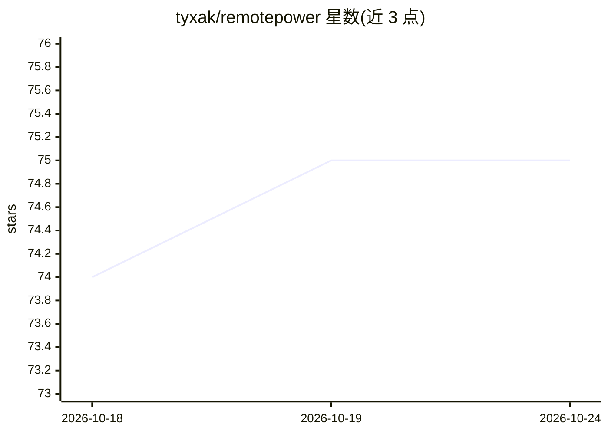

# tyxak/remotepower

⭐ 75 · Python · MIT · 推送 2026-10-21 · [GitHub](https://github.com/tyxak/remotepower) · [官网](https://remotepower.tvipper.com) · 个人维护

**自托管 Linux/Windows/macOS 服务器与服务器群监控运维平台**

单服务器加每主机一个小型 Python agent 的自托管运维套件：监控告警、资产 CMDB、CVE 扫描（OSV.dev，CISA KEV/EPSS 排序）、补丁与自动修补、OpenSCAP 合规扫描、工单 helpdesk、远程 shell/SSH 终端、Proxmox/VMware/OpenShift 生命周期管理及 MCP server。Agent 仅出站轮询，受管主机不开入站端口；6 位 PIN 注册。AI 为可选层：自带本地或云端模型，可对告警做只读调查并给出带证据的结论，也可完全关闭。Docker compose 或 install-server.sh 一条命令部署。

## 筛选速览

| 维度 | 判定 | 备注 |
|---|---|---|
| AI 角色 | `ai-enhanced` | 去掉 AI 部分产品仍成立 |
| 许可风险 | `permissive` | MIT |
| 部署形态 | `self-host` | docker 或自建部署 |
| 模型依赖 | — | README 未给出锁定关系 |
| 硬件要求 | — | 无带数字的原话,不猜 |
| 安装摩擦 | `low` | 无编译、无系统依赖或容器化 |
| 成熟度 | — | 结构信号不足 |

## 能力要点

- Agent 仅出站 HTTPS 轮询，受管主机无入站端口，6 位 PIN 注册
- 监控+CMDB+CVE 扫描+补丁+合规+工单+远程访问合一的自托管 Web UI
- AI 为可选层，可对告警做有界只读调查并输出带证据的结论
- 提供 48 个连接器、Prometheus/Grafana 端点与 MCP server

## 适用场景

- 统一替代分散的监控、CMDB、漏洞扫描、工单与跳板机服务
- 给 homelab 或服务器群做 CVE 扫描与合规报告
- 通过浏览器 SSH 终端和自动化修补策略远程运维主机

## 场景标签

`网络安全` · 领域:学习与行业

## 证据(README 行号)

> L66: out, and remote management. AI is an optional layer — bring your own local or
> L67: cloud model, or leave it switched off. With a model configured, it can also
> L68: triage an alert through a bounded read-only investigation and write a verdict

## 星数曲线

2026-10-18 74 → 2026-10-24 75（+1）

---
*卡片 v1 · prompt 1.4 · 生成 2026-10-24 · 置信度 high · 依据 README sha `1489fd55db15` · [字段定义](../../DATASET.md)*
