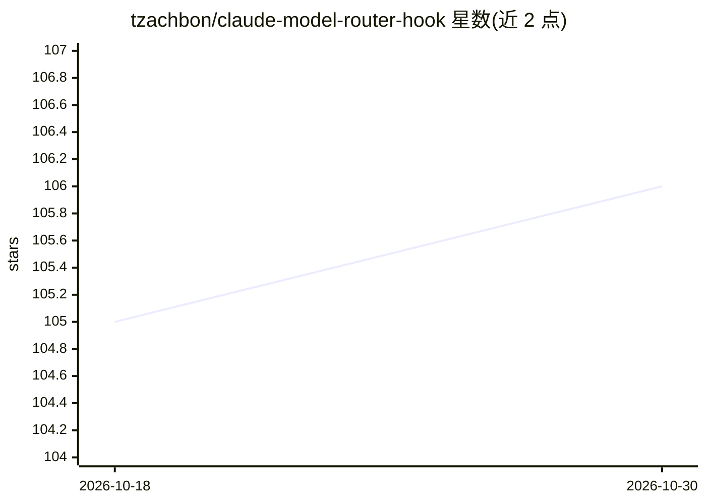

# tzachbon/claude-model-router-hook

⭐ 106 · Python · MIT · 推送 2026-09-02 · [GitHub](https://github.com/tzachbon/claude-model-router-hook) · [官网](https://tzachbon.github.io/claude-model-router-hook/) · 个人维护

**按任务复杂度为 Claude Code 自动切换模型档位的 hooks**

面向 Claude Code 用户的 hooks 插件：用本地启发式规则将每条 prompt 按任务类别（mechanical/implementation/debugging/architecture/extreme）分类，推荐匹配的 Claude 模型与 effort 档位（机械任务用 Haiku，编码与深度分析默认 Opus）。默认仅告警提示，自动切换需 opt-in 且只影响新会话；同时路由 Agent/Task 子代理生成，并记录请求与实际使用的模型。通过 UserPromptSubmit、PreToolUse、PostToolUse、SessionStart 四个 hook 实现，需 Claude Code 与 Python 3。

## 筛选速览

| 维度 | 判定 | 备注 |
|---|---|---|
| AI 角色 | `ai-ecosystem` | LLM/agent 周边工具 |
| 许可风险 | `permissive` | MIT |
| 部署形态 | `None` |  |
| 模型依赖 | — | README 未给出锁定关系 |
| 硬件要求 | — | 无带数字的原话,不猜 |
| 安装摩擦 | `low` | 无编译、无系统依赖或容器化 |
| 成熟度 | — | 结构信号不足 |

## 能力要点

- 按 5 类任务类别路由到对应模型与 effort 档位
- 默认告警模式，autoswitch 需显式开启且仅影响新会话
- 路由 Agent/Task 子代理生成并记录请求与实际使用的模型
- 错误时 fail open，prompt 前缀 ~ 或 < 可跳过路由

## 适用场景

- 降低 Claude Code 使用成本，机械任务自动降级到 Haiku
- 让子代理按任务类别匹配模型档位
- 通过日志审计请求模型与实际生效模型的差异

## 场景标签

`模型网关` · 领域:Agent 开发

## 证据(README 行号)

> L19: Claude Model Router classifies each prompt by task and effort, then recommends the matching Claude model. It warns 
> L33: |`UserPromptSubmit`|Classifies the prompt and warns or writes the next-session model.|
> L34: |`PreToolUse`|Routes `Agent` and `Task` spawns.|

## 星数曲线

2026-10-18 105 → 2026-10-30 106（+1）

---
*卡片 v1 · prompt 1.4 · 生成 2026-10-23 · 置信度 high · 依据 README sha `a14f8b3288de` · [字段定义](../../DATASET.md)*
