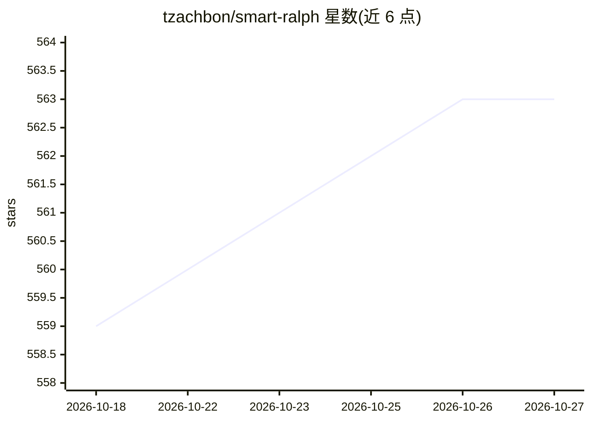

# tzachbon/smart-ralph

⭐ 563 · Shell · MIT · 推送 2026-09-16 · [GitHub](https://github.com/tzachbon/smart-ralph) · 个人维护

**面向 Claude Code/Codex 的规格驱动开发插件，逐任务执行特性**

Claude Code 与 OpenAI Codex 的插件，将特性请求转换为 research、requirements、design、tasks 等结构化规格文件，再由分阶段 agent（triage-analyst、research-analyst、product-manager、architect-reviewer、task-executor 等）逐任务执行，每个任务以新上下文开始，进度记录在 .progress.md 并支持会话中断后恢复。任务遵循 POC、重构、测试、质量门四阶段。另含代码库索引命令生成可搜索组件规格，以及适配 GitHub Spec-Kit 方法论的第二插件 ralph-speckit。执行循环自包含、无外部插件依赖。

## 筛选速览

| 维度 | 判定 | 备注 |
|---|---|---|
| AI 角色 | `ai-ecosystem` | LLM/agent 周边工具 |
| 许可风险 | `permissive` | MIT |
| 部署形态 | `None` |  |
| 模型依赖 | locked-api |  |
| 硬件要求 | — | 无带数字的原话,不猜 |
| 安装摩擦 | `low` | 无编译、无系统依赖或容器化 |
| 成熟度 | — | 结构信号不足 |

## 能力要点

- 特性请求转为 research/requirements/design/tasks 规格文件后逐任务执行
- 7 个分工 agent 的分阶段执行模型与 --quick 模式
- 代码库索引生成 specs/.index/ 下的可搜索组件规格
- 附带适配 GitHub Spec-Kit 方法论的 ralph-speckit 备选插件

## 适用场景

- 让编码代理按规格文件分阶段完成整个特性开发
- 在多特性大型目标上用 triage 拆分为依赖感知的 epic
- 为已有代码库建立组件索引供研究 agent 检索

## 场景标签

`编码 Agent` `多智能体` · 领域:Agent 开发

## 证据(README 行号)

> L11: **Spec-driven development for Claude Code and Codex.**
> L13: Smart Ralph turns a feature request into a structured spec, then executes it one task at a time with fresh context.

## 星数曲线

2026-10-18 559 → 2026-10-27 563（+4）

---
*卡片 v1 · prompt 1.4 · 生成 2026-10-21 · 置信度 high · 依据 README sha `d0761320ff15` · [字段定义](../../DATASET.md)*
