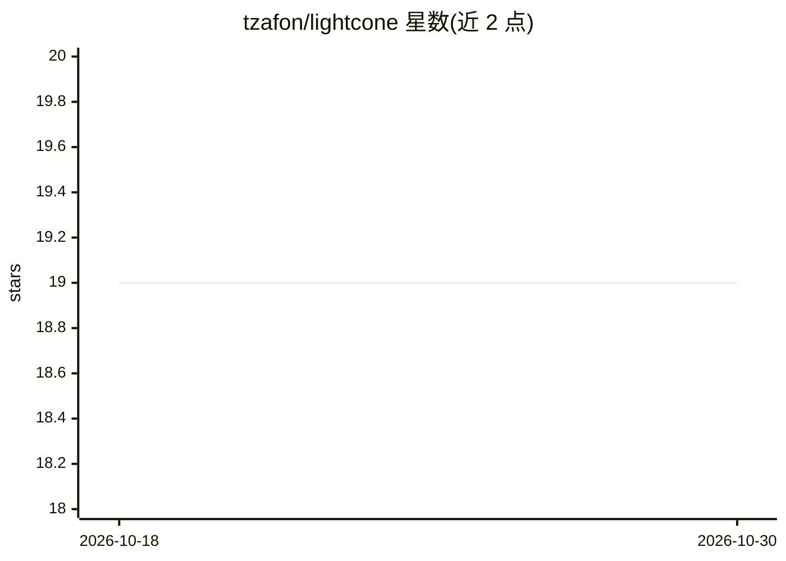

# tzafon/lightcone

⭐ 19 · Python · Apache-2.0 · 推送 2026-07-16 · [GitHub](https://github.com/tzafon/lightcone) · [官网](https://lightcone.ai) · 组织维护

**调用 Northstar 视觉语言模型的计算机操作 agent SDK**

Tzafon 提供的 SDK/API，用于接入其视觉语言模型 Northstar CUA Fast：输入截图与文本任务，模型输出 click/type/scroll/drag 等 GUI 动作（坐标 0-999 归一化），由用户执行动作并回传结果构成 CUA 循环。提供 Python 与 TypeScript SDK、10 个示例（桌面操作、浏览器循环、多标签、人在回路等）及 OSWorld 基准评测脚本。模型为 API 付费调用（$1/M 输入、$5/M 输出），代码本体以 Apache 2.0 开源。

## 筛选速览

| 维度 | 判定 | 备注 |
|---|---|---|
| AI 角色 | `ai-ecosystem` | LLM/agent 周边工具 |
| 许可风险 | `permissive` | Apache-2.0 |
| 部署形态 | `library` | 以包/库形式分发 |
| 模型依赖 | — | README 未给出锁定关系 |
| 硬件要求 | — | 无带数字的原话,不猜 |
| 安装摩擦 | `low` | 无编译、无系统依赖或容器化 |
| 成熟度 | — | 结构信号不足 |

## 能力要点

- 截图+文本输入，输出结构化 GUI 动作（click/type/scroll/drag 等）
- Responses API 服务端管理多轮会话，坐标已缩放到视图像素
- 提供 Python（pip install tzafon）与 TypeScript（npm）两种 SDK
- 附 10 个示例与 OSWorld 基准评测 harness

## 适用场景

- 让模型代替人操作浏览器或桌面完成表单、检索等任务
- 搭建自定义计算机操作 agent 循环并逐步执行动作
- 在 OrangeHRM/SuiteCRM 等企业应用上评测 agent 可靠性

## 场景标签

`GUI 自动化` `Agent 框架` · 领域:Agent 开发

## 证据(README 行号)

> L3: ### The API for Northstar, a vision-language model by Tzafon
> L16: Northstar sees screens and acts on them. Give it a screenshot, it decides where to click, what to type, when to scr
> L52: For full control, build the loop yourself. Northstar looks at a screenshot, decides the next action, you execute it

## 星数曲线

2026-10-18 19 → 2026-10-30 19（+0）

---
*卡片 v1 · prompt 1.4 · 生成 2026-10-28 · 置信度 high · 依据 README sha `9bd3dabb2a32` · [字段定义](../../DATASET.md)*
