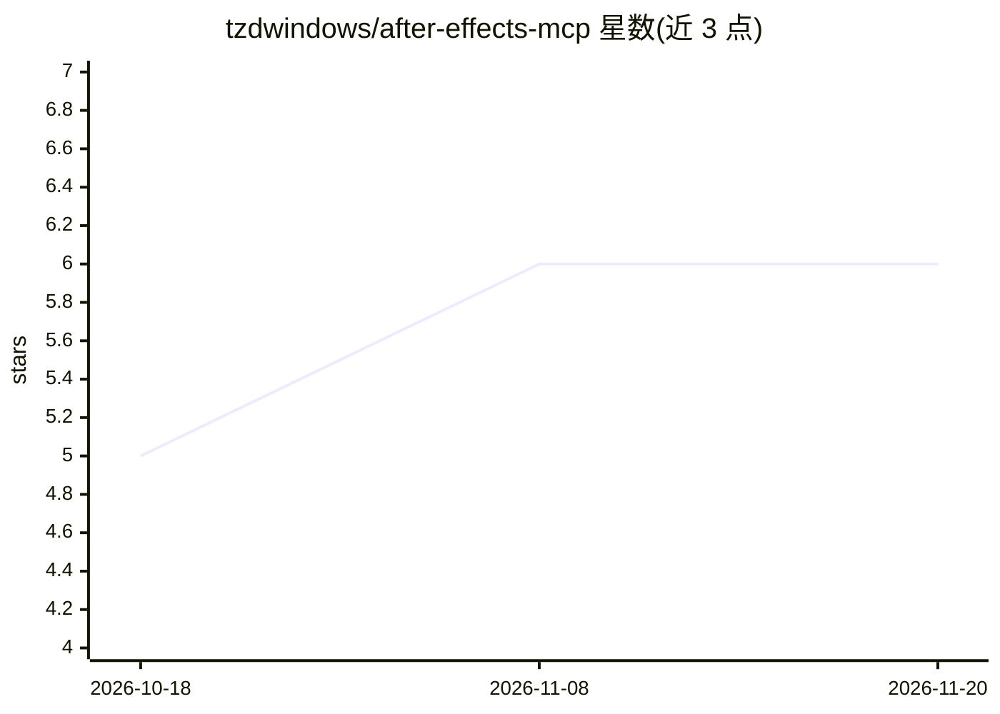

# tzdwindows/after-effects-mcp

⭐ 6 · TypeScript · MIT · 推送 2026-10-23 · [GitHub](https://github.com/tzdwindows/after-effects-mcp) · 个人维护 · 中文 README

**让 AI 客户端通过 MCP 控制 After Effects 的服务端**

面向 Adobe After Effects (2025/2026/CC) 的 MCP 服务端，通过 ExtendScript ScriptUI 桥接面板在 AE 后台监听指令，无需手动点击。工具覆盖合成管理、图层与文字动画、3D 摄像机运镜、关键帧速度曲线、插件特效、帧截图与预览视频导出，v1.1 起内置 MMS/CTC 歌词对齐、DOVER-Mobile 视频评分、MusiCNN 音乐情绪等模型，并提供自动保存与一键回滚。需先在 AE 中开启脚本网络权限并保持面板开启。

## 筛选速览

| 维度 | 判定 | 备注 |
|---|---|---|
| AI 角色 | `ai-ecosystem` | LLM/agent 周边工具 |
| 许可风险 | `permissive` | MIT |
| 部署形态 | `desktop` | 安装包/桌面程序 |
| 模型依赖 | — | README 未给出锁定关系 |
| 硬件要求 | — | 无带数字的原话,不猜 |
| 安装摩擦 | `medium` | 含编译或系统依赖之一 |
| 成熟度 | — | 结构信号不足 |

## 能力要点

- 通过 MCP 协议向 Claude Desktop、Cursor 等客户端暴露 AE 控制工具
- 内置 ExtendScript ScriptUI 后台面板，自动监听指令
- 内置 MMS/CTC 歌词对齐、DOVER-Mobile 视频评分、MusiCNN 情绪标签等模型
- 提供自动保存、回滚与备份清理机制

## 适用场景

- 用自然语言让 AI 创建合成、文字图层并执行摄像机运镜
- 根据音频 BPM 自动打节拍标记并生成卡点字幕图层
- 对渲染视频做质量/美学打分并检测画面截断
- 导出帧截图与低清预览视频检查效果

## 场景标签

`GUI 自动化` `视频生成` `图像视频处理` · 领域:效率与自动化

## 证据(README 行号)

> L13: 针对 Adobe After Effects（2025 / 2026 / CC）的专业级 Model Context Protocol (MCP) 服务端。提供合成管理、图层变换、空间速度缓动曲线、插件与特效系统、3D图层/灯光/
> L59: ### 步骤 4：在 MCP 客户端中配置
> L110: A production-ready Model Context Protocol (MCP) server for Adobe After Effects (2025 / 2026 / CC). Enables direct 

## 星数曲线

2026-10-18 5 → 2026-11-20 6（+1）

---
*卡片 v1 · prompt 1.4 · 生成 2026-11-20 · 置信度 high · 依据 README sha `351fead1d271` · [字段定义](../../DATASET.md)*
