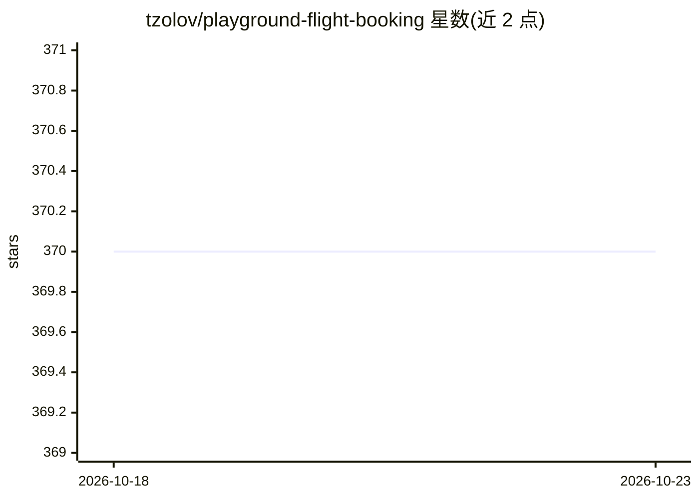

# tzolov/playground-flight-booking

⭐ 370 · Java · 推送 2026-02-14 · [GitHub](https://github.com/tzolov/playground-flight-booking) · [官网](https://docs.spring.io/spring-ai/reference/1.0-SNAPSHOT/index.html) · 个人维护

**基于 Spring AI 的航班预订专家系统演示（RAG+工具调用）**

对 marcushellberg/java-ai-playground 的 Spring AI 重实现，以航班预订为场景演示 AI 专家系统的构建：通过 RAG 检索条款与条件文档、Function Calling 调用 Java 方法执行操作、LLM 驱动对话交互。支持 OpenAI、VertexAI Gemini、Azure OpenAI、Groq、Anthropic Claude 五种模型接入方式。要求 Java 17+ 与对应 API key，可在 IDE 或 mvn 运行，使用 pgvector 向量数据库容器。

## 筛选速览

| 维度 | 判定 | 备注 |
|---|---|---|
| AI 角色 | `ai-native` | 本体是模型或模型工具 |
| 许可风险 | `none` | — |
| 部署形态 | `self-host` | docker 或自建部署 |
| 模型依赖 | locked-api |  |
| 硬件要求 | — | 无带数字的原话,不猜 |
| 安装摩擦 | `low` | 无编译、无系统依赖或容器化 |
| 成熟度 | — | 结构信号不足 |

## 能力要点

- RAG 检索条款文档 + Function Calling 调用 Java 方法
- 支持 OpenAI / VertexAI Gemini / Azure OpenAI / Groq / Anthropic 五种模型配置
- Groq 复用 OpenAI Chat client 指向 Groq endpoint
- 提供 mvn 打包与 jar 运行方式

## 适用场景

- 学习 Spring AI 中 RAG 与工具调用的集成方式
- 参考多 LLM 供应商的 Spring Boot 配置切换
- 作为 Spring AI 应用的起点模板进行二次开发

## 场景标签

 · 领域:LLM 应用/Java 开发

## 证据(README 行号)

> L5: This app shows how you can use Spring AI to build an AI-powered system that:
> L8: - Can access tools (Java methods) to perform actions (Function Calling)

## 星数曲线

2026-10-18 370 → 2026-10-23 370（+0）

---
*卡片 v1 · prompt 1.4 · 生成 2026-10-21 · 置信度 mid · 依据 README sha `9c7f493d4410` · [字段定义](../../DATASET.md)*
