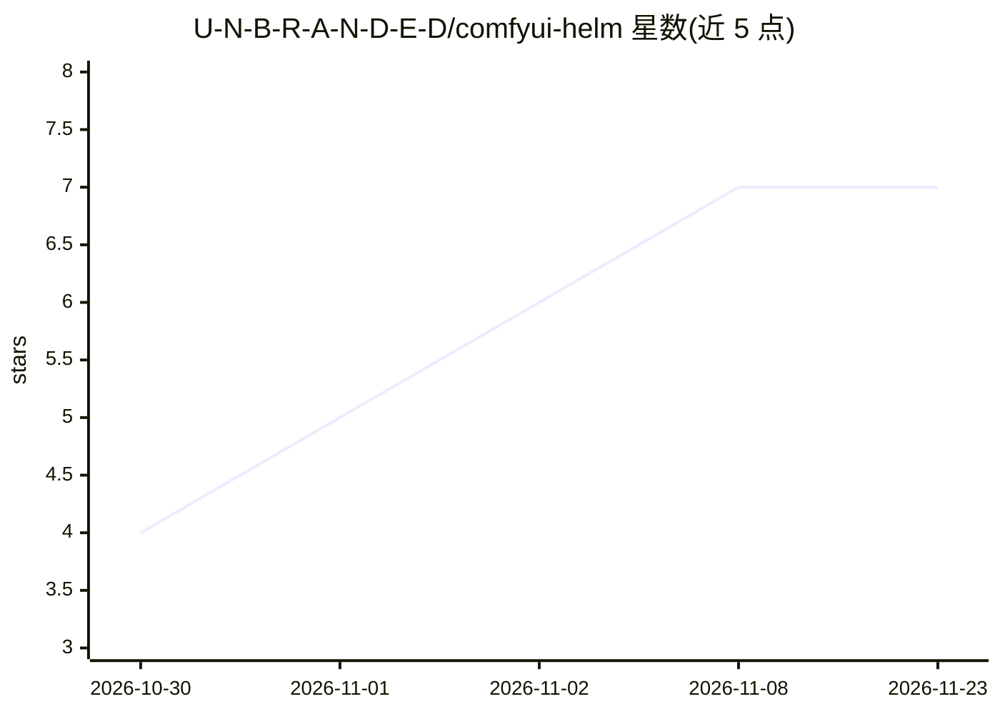

# U-N-B-R-A-N-D-E-D/comfyui-helm

⭐ 7 · Python · MIT · 推送 2026-11-18 · [GitHub](https://github.com/U-N-B-R-A-N-D-E-D/comfyui-helm) · [官网](https://www.kafein.agency/unbranded/helm) · 个人维护

**ComfyUI 无训练激活导向插件：用一个标量调节图像/视频生成方向**

面向 ComfyUI 的 activation steering 节点套件：对同一模型做两次对比推理，从 transformer 激活中提取方向并保存为约 16–22 KB 的 .safetensors 轴文件，之后用一个 0–1 的 strength 标量在采样时注入该方向，不修改权重、不训练。作者给出 78 个方向的基准（10/53 在预注册标准下成立，43 个 wash out），并提供 Before/After 模板、自制轴工作流与 headless API 运行路径。仅在开放权重模型上测量过 MiniMax H3 与 Z-Image；部分模板（Krea2/LTX）标记为未执行验证。

## 筛选速览

| 维度 | 判定 | 备注 |
|---|---|---|
| AI 角色 | `ai-native` | 本体是模型或模型工具 |
| 许可风险 | `permissive` | MIT |
| 部署形态 | `library` | 以包/库形式分发 |
| 模型依赖 | — | README 未给出锁定关系 |
| 硬件要求 | — | 无带数字的原话,不猜 |
| 安装摩擦 | `low` | 无编译、无系统依赖或容器化 |
| 成熟度 | — | 结构信号不足 |

## 能力要点

- 两次对比推理提取激活方向，保存为 ~22 KB .safetensors 轴
- 单标量 0–1 注入，strength=0 时字节级零影响，不改模型权重
- 可堆叠多个 HelmApply 节点，带 safe_max 钳制
- 附带 78 轴基准数据与自制轴（Make Axis）工作流

## 适用场景

- 在 ComfyUI 中用滑块调节生成画面里的雾、杂物、光线角度等属性
- 为视频/图像 DiT 模型录制并构建自定义导向轴
- 通过 Comfy SDK 以 headless/API 方式运行导向工作流

## 场景标签

`图像生成` `视频生成` · 领域:内容生成

## 证据(README 行号)

> L24: That's Helm — training-free activation steering for ComfyUI and the Comfy Developer Platform. You feed it two contr
> L82: comfy node install comfyui-helm

## 星数曲线

2026-10-30 4 → 2026-11-23 7（+3）

---
*卡片 v1 · prompt 1.4 · 生成 2026-11-20 · 置信度 high · 依据 README sha `9da30ccf55b0` · [字段定义](../../DATASET.md)*
