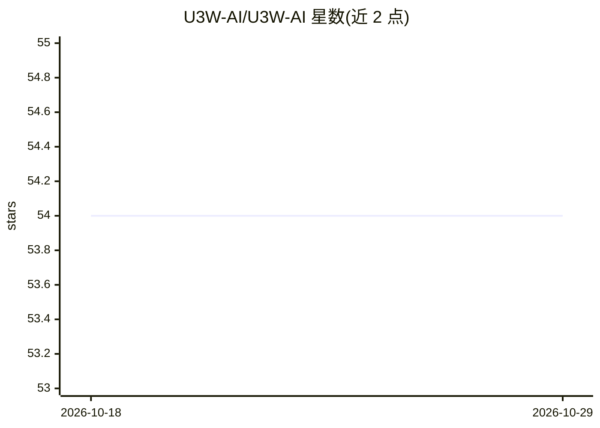

# U3W-AI/U3W-AI

⭐ 54 · Java · AGPL-3.0 · 推送 2026-08-25 · [GitHub](https://github.com/U3W-AI/U3W-AI) · [官网](https://www.fbsir.com/) · 组织维护 · 中文 README

**面向中小团队的内容协作自动化系统（Admin+Engine 前后端分离）**

福帮手 FBSir 是前后端分离的内容协作自动化系统：Admin 作为控制面，Engine 作为自动化执行节点，覆盖企业微信智能机器人编排、Webhook 管理、内容与长文档处理、场景包、积分与权限治理。后端 Spring Boot 3/Java 17，前端 Vue 3/Vite 6，Engine 使用 Playwright 与 WebSocket。本地基础闭环需 MySQL 8、Redis 6+ 与 Node.js 18；Gitee OAuth、企微回调、第三方 AI 平台等外部服务按场景启用，未配置不影响基础后台启动。AGPL-3.0 开源。

## 筛选速览

| 维度 | 判定 | 备注 |
|---|---|---|
| AI 角色 | `ai-enhanced` | 去掉 AI 部分产品仍成立 |
| 许可风险 | `viral` | AGPL-3.0 |
| 部署形态 | `None` |  |
| 模型依赖 | — | README 未给出锁定关系 |
| 硬件要求 | — | 无带数字的原话,不猜 |
| 安装摩擦 | `medium` | 含编译或系统依赖之一 |
| 成熟度 | — | 结构信号不足 |

## 能力要点

- Admin 控制面 + Engine 自动化执行节点的前后端分离架构
- 企业微信机器人编排、Webhook 管理、长文档处理
- 26 步数据库初始化脚本，重复执行跳过已完成步骤
- 场景包、积分与权限治理功能

## 适用场景

- 中小团队搭建企业微信机器人与内容自动化流程
- 统一管理 Webhook 与长文档内容处理任务
- 通过场景包与积分权限体系组织团队协作

## 场景标签

`浏览器自动化` `工作流自动化` · 领域:效率与自动化

## 证据(README 行号)

> L5: 福帮手是一个以 Admin 为控制面、Engine 为自动化执行节点的前后端分离系统，包含企业微信智能机器人编排、Webhook 管理、内容与长文档处理、场景包、积分和权限治理等能力。

## 星数曲线

2026-10-18 54 → 2026-10-29 54（+0）

---
*卡片 v1 · prompt 1.4 · 生成 2026-10-24 · 置信度 mid · 依据 README sha `551667459048` · [字段定义](../../DATASET.md)*
