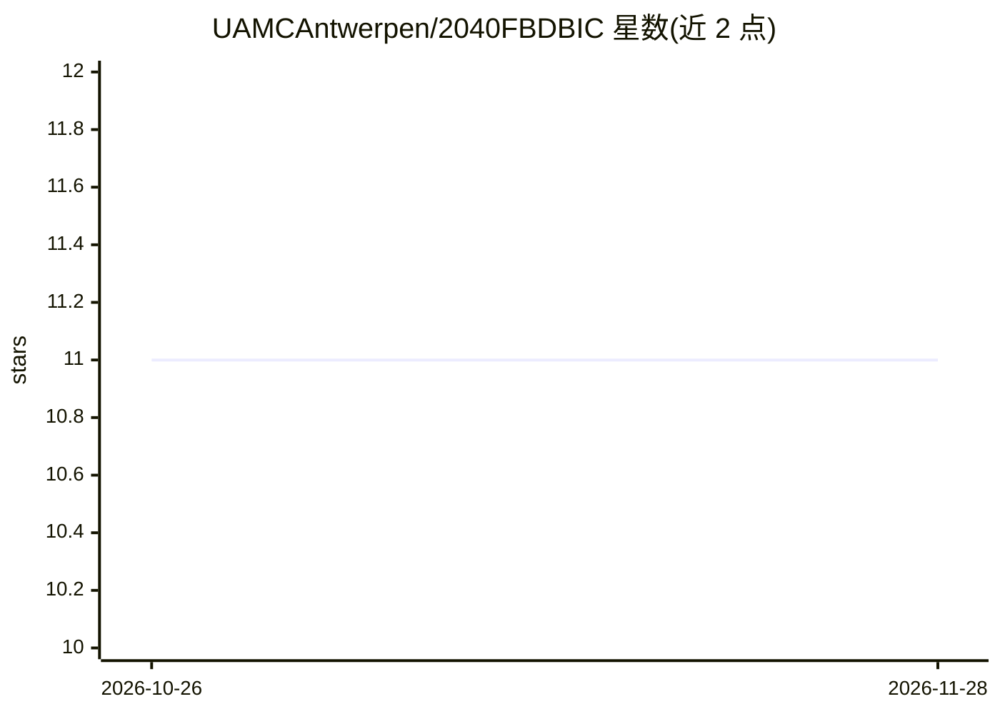

# UAMCAntwerpen/2040FBDBIC

⭐ 11 · Jupyter Notebook · 推送 2026-11-19 · [GitHub](https://github.com/UAMCAntwerpen/2040FBDBIC) · 组织维护

**安特卫普大学化学信息学与计算药物设计课程材料**

安特卫普大学（比利时）"Chemo-informatics and computational drug design"课程的全部教学材料仓库，以 Jupyter notebook 形式按序组织，主题覆盖蛋白质处理、小分子处理、机器学习模型构建、MDM2 结合剂数据库、药效团搜索与分子对接。README 列出 Notebook-0 至 Notebook-6 的学习顺序，供选课学生与自学化学信息学者按顺序学习。

## 筛选速览

| 维度 | 判定 | 备注 |
|---|---|---|
| AI 角色 | `ai-knowledge` | 知识聚合/清单类 |
| 许可风险 | `none` | — |
| 部署形态 | `None` |  |
| 模型依赖 | — | README 未给出锁定关系 |
| 硬件要求 | — | 无带数字的原话,不猜 |
| 安装摩擦 | `low` | 无编译、无系统依赖或容器化 |
| 成熟度 | — | 结构信号不足 |

## 能力要点

- 7 个按学习顺序编排的 Jupyter notebook
- 覆盖 ML 模型构建、药效团搜索、分子对接等主题
- 含 MDM2 结合剂数据库构建实践内容

## 适用场景

- 按 notebook 顺序自学化学信息学
- 为药物设计课程准备教学内容
- 练习蛋白质与小分子的计算处理流程

## 场景标签

`教程课程` · 领域:学习与行业

## 证据(README 行号)

> L1: # 2040FBDBIC - Chemo-informatics and computational drug design
> L3: Course materials for "Chemo-informatics and computational drug design" at the University of Antwerp.
> L5: Start with the notebooks in order:

## 星数曲线

2026-10-26 11 → 2026-11-28 11（+0）

---
*卡片 v1 · prompt 1.4 · 生成 2026-11-18 · 置信度 high · 依据 README sha `1bdd50681ace` · [字段定义](../../DATASET.md)*
