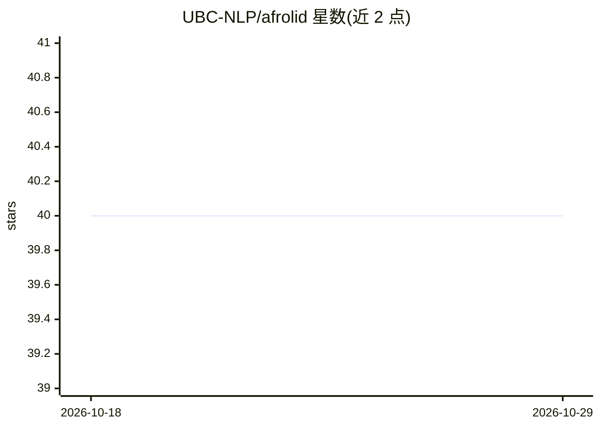

# UBC-NLP/afrolid

⭐ 40 · Python · Apache-2.0 · 推送 2026-02-05 · [GitHub](https://github.com/UBC-NLP/afrolid) · [官网](https://demos.dlnlp.ai/afrolid/) · 组织维护

**面向 517 种非洲语言/变体的神经语言识别工具包**

UBC-NLP 发布的神经语言识别（LID）工具包，覆盖 517 种非洲语言及变体，基于 14 个语系、5 种正字法系统的人工筛选多领域网络数据训练；v1.5 在 SERENGETI 多语言模型上微调，macro-F1 从 95.95 提升至 97.41，构建于 Hugging Face Transformers 之上，可用 pipeline 一行调用，另提供 pip 安装的 Python 包、CLI 及 Colab 示例，模型权重需单独下载，代码与模型均按 Apache-2.0 提供。

## 筛选速览

| 维度 | 判定 | 备注 |
|---|---|---|
| AI 角色 | `ai-native` | 本体是模型或模型工具 |
| 许可风险 | `permissive` | Apache-2.0 |
| 部署形态 | `library` | 以包/库形式分发 |
| 模型依赖 | — | README 未给出锁定关系 |
| 硬件要求 | — | 无带数字的原话,不猜 |
| 安装摩擦 | `low` | 无编译、无系统依赖或容器化 |
| 成熟度 | — | 结构信号不足 |

## 能力要点

- 覆盖 517 种非洲语言与变体的语言识别
- v1.5 基于 SERENGETI 微调，macro-F1 报告为 97.41
- 支持 Hugging Face pipeline 一行调用与 CLI
- 提供 pip 安装、Colab 示例与 Pandas 集成示例

## 适用场景

- 识别非洲语言文本的语言 ID 标签
- 在 Python 数据处理流程中批量做语言识别
- 为低资源非洲语言 NLP 流程做前置语言过滤

## 场景标签

 · 领域:NLP/语言识别

## 证据(README 行号)

> L17: AfroLID, a neural LID toolkit for 517 African languages and varieties. AfroLID exploits a multi-domain web dataset 
> L32: afrolid = pipeline("text-classification", model='UBC-NLP/afrolid_1.5', use_fast=False)

## 星数曲线

2026-10-18 40 → 2026-10-29 40（+0）

---
*卡片 v1 · prompt 1.4 · 生成 2026-10-25 · 置信度 high · 依据 README sha `2017393c1cb7` · [字段定义](../../DATASET.md)*
