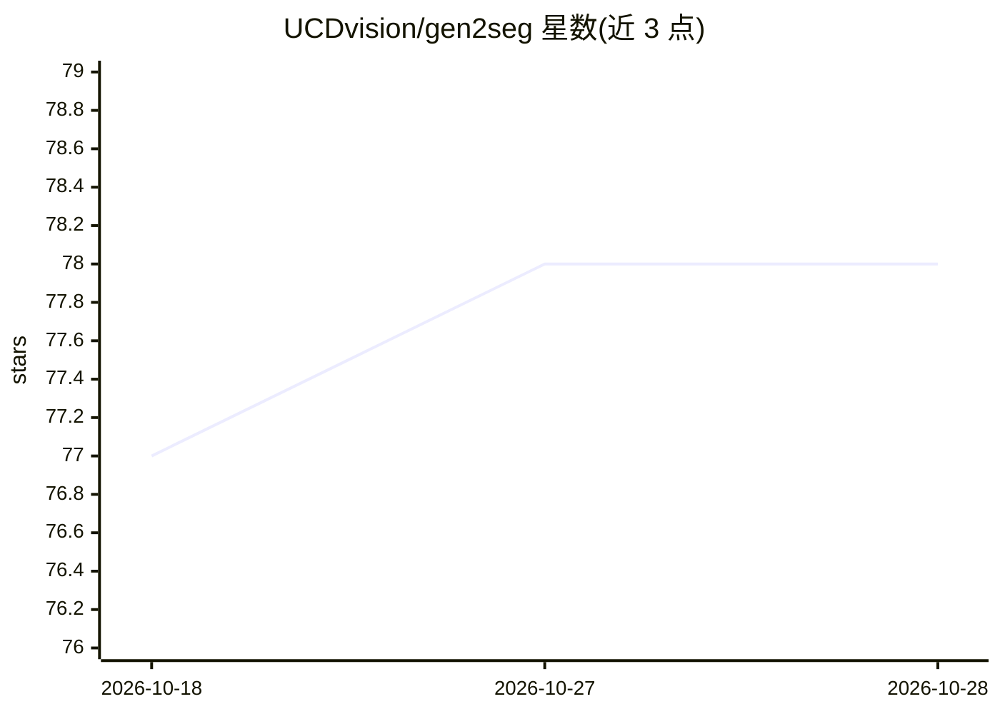

# UCDvision/gen2seg

⭐ 78 · Python · 推送 2026-02-09 · [GitHub](https://github.com/UCDvision/gen2seg) · [官网](https://reachomk.github.io/gen2seg/) · 组织维护

**基于生成模型的通用实例分割方法（ICLR 2026 代码）**

UC Davis 团队在 ICLR 2026 发表的 gen2seg 论文官方代码：将 Stable Diffusion 2 与 MAE-Huge 生成模型微调用于实例分割，实现跨域泛化的实例分割。提供两个 Hugging Face 预训练模型、推理脚本与交互式点提示（prompting）生成分割掩码，训练需约 24-48GB GPU 与 Hypersim、Virtual Kitti 2 两个合成数据集。安装以 conda 环境为主，训练代码环境细节尚未完全发布。

## 筛选速览

| 维度 | 判定 | 备注 |
|---|---|---|
| AI 角色 | `ai-native` | 本体是模型或模型工具 |
| 许可风险 | `none` | — |
| 部署形态 | `library` | 以包/库形式分发 |
| 模型依赖 | — | README 未给出锁定关系 |
| 硬件要求 | — | 无带数字的原话,不猜 |
| 安装摩擦 | `low` | 无编译、无系统依赖或容器化 |
| 成熟度 | — | 结构信号不足 |

## 能力要点

- 基于 Stable Diffusion 2 与 MAE-Huge 的实例分割模型，Hugging Face 提供预训练权重
- prompting.py 支持像素点提示生成分割掩码，含 sigma/threshold 可调参数
- 提供 SD 与 MAE 两条训练脚本与多 GPU 并行配置
- 附 SAM 推理脚本用于定性对比

## 适用场景

- 对输入图像运行通用实例分割推理
- 用点提示交互式提取目标掩码
- 在 Hypersim/Virtual Kitti 2 上复现模型训练

## 场景标签

`目标检测` · 领域:感知与多模态

## 证据(README 行号)

> L1: # [ICLR 2026] gen2seg: Generative Models Enable Generalizable Instance Segmentation
> L6: **gen2seg: Generative Models Enable Generalizable Instance Segmentation**
> L29: Currently, we have released inference code for our SD and MAE models. You can run them by editing the `image_path` 

## 星数曲线

2026-10-18 77 → 2026-10-28 78（+1）

---
*卡片 v1 · prompt 1.4 · 生成 2026-10-24 · 置信度 mid · 依据 README sha `9c6c0a942b19` · [字段定义](../../DATASET.md)*
