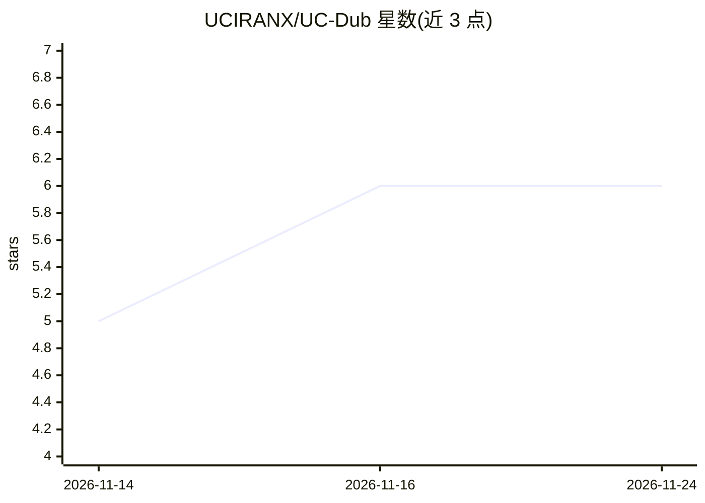

# UCIRANX/UC-Dub

⭐ 6 · Kotlin · 推送 2026-11-08 · [GitHub](https://github.com/UCIRANX/UC-Dub) · [官网](https://t.me/UCIRANIR) · 个人维护

**安卓端 Gemini Live 实时翻译配音：手机内音频配波斯语字幕**

Android 应用（Kotlin）：通过 AudioPlaybackCapture 捕获手机内正在播放的音频，转为 16kHz mono 后发送至 Gemini Live（gemini-3.5-live-translate-preview）做语音翻译，以 AudioTrack 播放翻译语音并在任意应用上悬浮显示原文与译文。支持 100+ 目标语言（默认波斯语）、三种输出模式、多 API key 轮换。最低 Android 10，需自备 Google AI Studio 的 Gemini API key；DRM 流媒体无法录制，翻译延迟约 1–3 秒，无 Google 服务的机型语言识别（ML Kit）可能不可用。

## 筛选速览

| 维度 | 判定 | 备注 |
|---|---|---|
| AI 角色 | `ai-native` | 本体是模型或模型工具 |
| 许可风险 | `none` | — |
| 部署形态 | `None` |  |
| 模型依赖 | — | README 未给出锁定关系 |
| 硬件要求 | — | 无带数字的原话,不猜 |
| 安装摩擦 | `low` | 无编译、无系统依赖或容器化 |
| 成熟度 | — | 结构信号不足 |

## 能力要点

- AudioPlaybackCapture 捕获手机内音频，Gemini Live 实时语音翻译
- 配音 + 悬浮字幕两种输出可组合选择（三种模式）
- 多 API key 自动轮换，达到限额自动切换
- 目标语言 100+，默认波斯语，可标记不配音语言

## 适用场景

- 看外语视频时同步听波斯语配音并显示双语字幕
- 在任意应用中翻译手机内播放的语音内容
- 为特定语言关闭配音、只保留原文播放

## 场景标签

 · 领域:工具/语言翻译

## 证据(README 行号)

> L25:  صدای گوشی ──► ضبط با AudioPlaybackCapture ──► تبدیل به 16kHz mono
> L33: 2. صدا به **Gemini Live** (`gemini-3.5-live-translate-preview`) فرستاده می‌شود.

## 星数曲线

2026-11-14 5 → 2026-11-24 6（+1）

---
*卡片 v1 · prompt 1.4 · 生成 2026-11-20 · 置信度 high · 依据 README sha `84a4b01207a9` · [字段定义](../../DATASET.md)*
