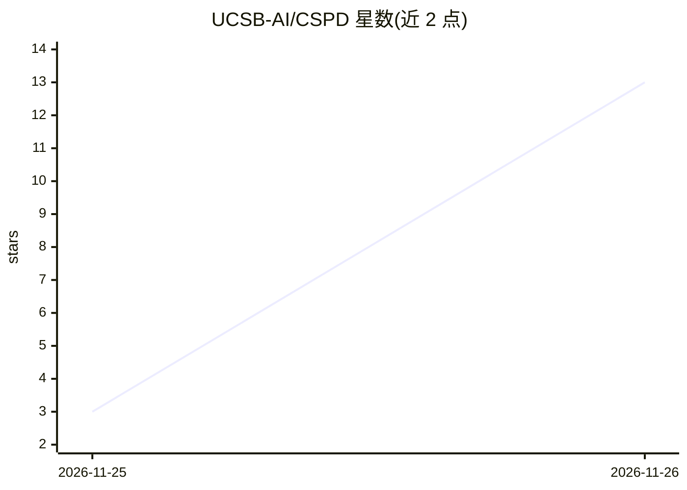

# UCSB-AI/CSPD

⭐ 13 · Python · NOASSERTION · 推送 2026-11-23 · [GitHub](https://github.com/UCSB-AI/CSPD) · [官网](https://arxiv.org/abs/2611.27376) · 组织维护

**给 RL 研究者：把各领域 RL 专家蒸馏为可拼接的软提示**

论文配套代码库：将 RL 后训练得到的领域专家逐一蒸馏为 256 个可训练输入向量组成的软提示（骨干模型冻结，仅用 response-only LM loss 训练提示），推理时按顺序拼接多个提示实现专家组合，无需联合训练。提供 prefix-robust 训练、M2RL 上四个领域提示的复现流程、compose.py 校验 SHA-256，以及 Table 1-3 与吞吐量实验的完整脚本；生成依赖 SGLang/vLLM 环境，训练需 GPU（论文在 B200 上测得）。许可为 CC BY-NC 4.0。

## 筛选速览

| 维度 | 判定 | 备注 |
|---|---|---|
| AI 角色 | `ai-native` | 本体是模型或模型工具 |
| 许可风险 | `none` | NOASSERTION |
| 部署形态 | `library` | 以包/库形式分发 |
| 模型依赖 | local-ok | 支持本地模型 |
| 硬件要求 | — | 无带数字的原话,不猜 |
| 安装摩擦 | `low` | 无编译、无系统依赖或容器化 |
| 成熟度 | — | 结构信号不足 |

## 能力要点

- 每个专家一个软提示，推理时拼接组合，骨干全程冻结
- 单提示在 23 个设置中的 22 个恢复教师至少 90% 的增益
- soft prompt 吞吐量接近骨干（差 1.5%），为 rank-4 LoRA 的 2.40×
- 提供 coding agent 提示词与 AGENTS.md 用于复现论文表格

## 适用场景

- 在已 SFT 的模型上持续叠加新领域 RL 专家而不重训全模型
- 用已发布的四个软提示直接复现论文的组合评测结果
- 研究提示拼接顺序对多领域能力的影响

## 场景标签

`提示工程` `模型评测` `强化学习` · 领域:Agent 开发

## 证据(README 行号)

> L7: Code for **Composable Soft-Prompt Distillation of RL Experts: Toward Continual Post-Training**.
> L9: RL post-training produces domain experts that must then be consolidated into one model. Weight merging and multi-tea

## 星数曲线

2026-11-25 3 → 2026-11-26 13（+10）

---
*卡片 v1 · prompt 1.4 · 生成 2026-11-24 · 置信度 high · 依据 README sha `52966bedf1d0` · [字段定义](../../DATASET.md)*
