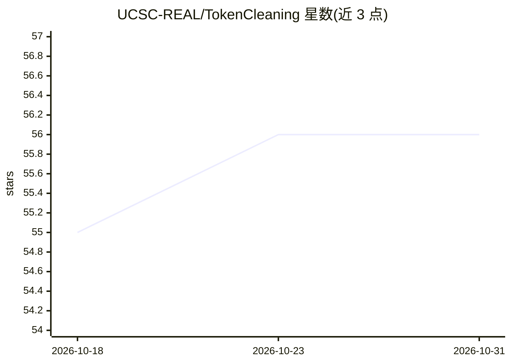

# UCSC-REAL/TokenCleaning

⭐ 56 · Python · Apache-2.0 · 推送 2026-10-24 · [GitHub](https://github.com/UCSC-REAL/TokenCleaning) · [官网](https://arxiv.org/pdf/2502.01968) · 组织维护

**ICML 2025 论文实现：面向 LLM SFT 的 token 级数据选择方法**

UC Santa Cruz 团队发表的 ICML 2025 论文官方代码实现。提出从噪声标签视角评估 token 质量的清洗流水线：先度量模型更新对各 token 的影响，再按阈值分离，过滤无信息量 token、保留任务关键信息。提供两种流水线：一次性处理的 Fixed-Model Cleaning 与迭代式的 Self-Evolving Cleaning。训练池基于 DS2 策展的 50k 样本（Huggingface 可获取），评测覆盖 MMLU、TruthfulQA 等基准，附带 baselines（full/random/rho）。面向复现论文或开展 SFT 数据选择研究的科研用户。

## 筛选速览

| 维度 | 判定 | 备注 |
|---|---|---|
| AI 角色 | `ai-ecosystem` | LLM/agent 周边工具 |
| 许可风险 | `none` | Apache-2.0 |
| 部署形态 | `library` | 以包/库形式分发 |
| 模型依赖 | — | README 未给出锁定关系 |
| 硬件要求 | — | 无带数字的原话,不猜 |
| 安装摩擦 | `low` | 无编译、无系统依赖或容器化 |
| 成熟度 | — | 结构信号不足 |

## 能力要点

- 基于模型更新影响度的 token 质量评估与阈值分离
- Fixed-Model（单次）与 Self-Evolving（迭代自演化参考模型）两种清洗流水线
- 50k 样本数据池经 Huggingface 分发，含 DS2 策展管线
- 提供 full/random/rho 基线实现与 lm-eval-harness 评测脚本

## 适用场景

- 复现 ICML 2025 Token Cleaning 论文结果
- SFT 前对指令微调数据做 token 级清洗与筛选
- 对比不同数据选择基线在微调任务上的效果

## 场景标签

`科研工具` · 领域:学习与行业

## 证据(README 行号)

> L8: This project investigates token quality from a noisy-label perspective and propose a generic token cleaning pipeline
> L12: - **Fixed-Model Cleaning** This pipeline applies a one-shot cleaning process to the entire dataset.
> L14: - **Self-Evolving Cleanning** This pipeline follows an iterative approach.

## 星数曲线

2026-10-18 55 → 2026-10-31 56（+1）

---
*卡片 v1 · prompt 1.4 · 生成 2026-10-24 · 置信度 mid · 依据 README sha `1b0edc6a8afe` · [字段定义](../../DATASET.md)*
