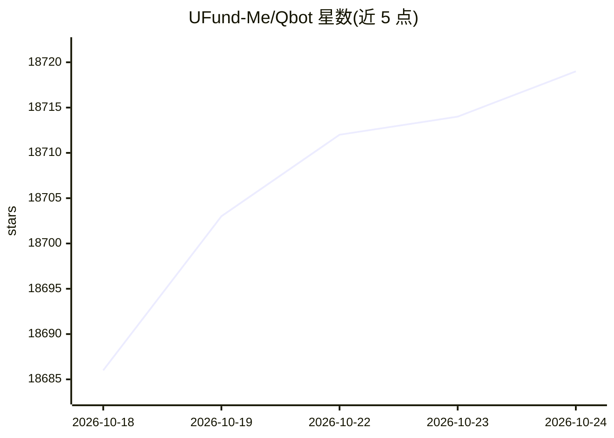

# UFund-Me/Qbot

⭐ 18,726 · Jupyter Notebook · MIT · 推送 2026-03-11 · [GitHub](https://github.com/UFund-Me/Qbot) · [官网](https://github.com/Charmve) · 组织维护 · 中文 README

**面向量化交易者的本地部署 AI 量化投研与自动交易平台**

以 Python 编写的量化投研平台，覆盖数据获取、策略开发、回测、模拟交易到实盘交易的流程，提供 GUI 前端与事件驱动后端。策略层包含经典技术指标策略与基于 qlib 的机器学习/深度学习/强化学习模型（Model Zoo 收录 300+ 模型、40+ 论文方法），支持股票、基金、期货、虚拟货币等交易对象，并接入多家券商与交易所接口。README 注明仅在 Python 3.8/3.9 下测试过，并提示交易结果不构成投资建议。

## 筛选速览

| 维度 | 判定 | 备注 |
|---|---|---|
| AI 角色 | `ai-enhanced` | 去掉 AI 部分产品仍成立 |
| 许可风险 | `permissive` | MIT |
| 部署形态 | `None` |  |
| 模型依赖 | — | README 未给出锁定关系 |
| 硬件要求 | — | 无带数字的原话,不猜 |
| 安装摩擦 | `low` | 无编译、无系统依赖或容器化 |
| 成熟度 | — | 结构信号不足 |

## 动量与使用信号

- 维护:`declining` — 距上次 push 220.8 天,年发版 0,3 位贡献者
- 涨星:近 1 天 **+14**(自 20261016 起算)
- 安装:pypi 包 `dev` 月下载无数据

## 能力要点

- 数据层、策略层、交易引擎的模块化分层设计
- Model Zoo 提供 300+ 模型、40+ 论文方法的训练与使用
- 覆盖股票/期货/期权/数字货币的多实盘交易接口
- 邮件、飞书、弹窗、微信多通道交易消息提示

## 适用场景

- 在本地环境开发并回测自己的量化交易策略
- 用机器学习模型做因子挖掘与股票预测
- 接入券商接口进行模拟盘或实盘自动化交易

## 场景标签

`金融量化` · 领域:学习与行业

## 证据(README 行号)

> L41: > Qbot is an AI-oriented automated quantitative investment platform, which aims to realize the potential, empower A
> L62: Qbot是一个免费的量化投研平台，提供从数据获取、交易策略开发、策略回测、模拟交易到最终实盘交易的全闭环流程。在实盘接入前，有股票、基金评测和策略回测，在模拟环境下做交易验证，近乎实盘的时延、滑点仿真。故，本平台提供GUI前端/客
> L288:  **Note:** All the about **300+ models, methods of 40+ papers** in quant.ai supported by Model Zoo can be trained 

## 星数曲线

2026-10-18 18,686 → 2026-10-24 18,719（+33）

---
*卡片 v1 · prompt 1.4 · 生成 2026-10-18 · 置信度 high · 依据 README sha `838c15136b04` · [字段定义](../../DATASET.md)*
