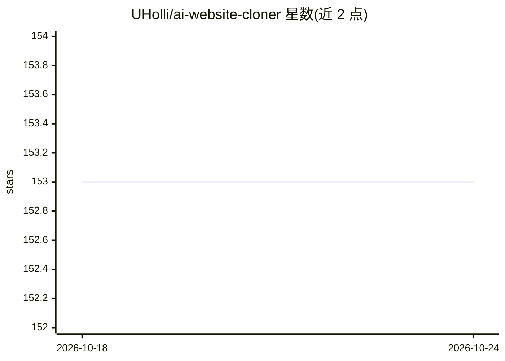

# UHolli/ai-website-cloner

⭐ 153 · TypeScript · MIT · 推送 2026-09-14 · [GitHub](https://github.com/UHolli/ai-website-cloner) · 个人维护

**Next.js 模板：配合 AI 编程 agent 重建线上网站为类型化代码**

面向使用 AI 编程 agent 重建线上网站场景的生产级 Next.js 模板：以 AGENTS.md 与 .claude/skills 中的 SKILL.md 为单一来源，通过 npm run sync:agents / sync:skills 生成到 Copilot、Cline、Continue、Amazon Q、Codex、Cursor、Gemini 等 10+ 平台的 agent 指令；提供 /clone-website 工作流（侦察→基础→组件规格）、可选 Redis 会话缓存与内存后备、严格 TypeScript 工具链和 Docker Compose 部署。模板本身不含自动化抓取，提取与生成由 coding agent 执行；建议 Claude Code。

## 筛选速览

| 维度 | 判定 | 备注 |
|---|---|---|
| AI 角色 | `ai-ecosystem` | LLM/agent 周边工具 |
| 许可风险 | `permissive` | MIT |
| 部署形态 | `self-host` | docker 或自建部署 |
| 模型依赖 | locked-api |  |
| 硬件要求 | — | 无带数字的原话,不猜 |
| 安装摩擦 | `low` | 无编译、无系统依赖或容器化 |
| 成熟度 | — | 结构信号不足 |

## 能力要点

- 单一 AGENTS.md/SKILL.md 来源同步到 10+ agent 平台
- /clone-website 多阶段克隆工作流与组件规格文档约定
- 可选 Redis 会话缓存 + 内存后备，/api/cache/* CRUD 接口
- Docker Compose（app/dev/Redis）与 lint/typecheck/test/build CI 流水线

## 适用场景

- 我用 Claude Code 等 coding agent 复刻网站为 Next.js 项目时作为起点模板
- 团队统一克隆工作流的 agent 指令与规格文档规范
- 多 agent 或 CI 环境下共享克隆会话状态（Redis）

## 场景标签

`编码 Agent` · 领域:编码与开发

## 证据(README 行号)

> L3: A production-oriented starter for rebuilding live websites as typed Next.js applications with AI coding agents. The 
> L15: |Agent instructions|Single source in `AGENTS.md`, synced to 10+ platforms|
> L139: |`.claude/skills/clone-website/SKILL.md`|Codex, Cursor, Gemini, …|`npm run sync:skills`|

## 星数曲线

2026-10-18 153 → 2026-10-24 153（+0）

---
*卡片 v1 · prompt 1.4 · 生成 2026-10-22 · 置信度 mid · 依据 README sha `a505da9909a2` · [字段定义](../../DATASET.md)*
