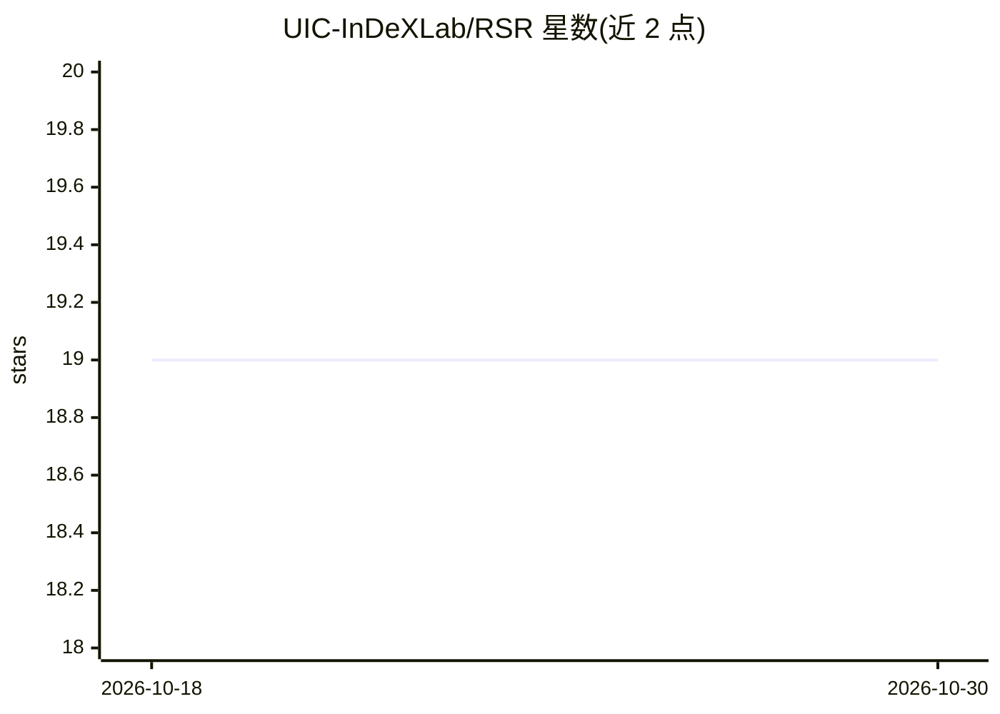

# UIC-InDeXLab/RSR

⭐ 19 · Python · MIT · 推送 2026-03-27 · [GitHub](https://github.com/UIC-InDeXLab/RSR) · [官网](https://arxiv.org/abs/2411.06360) · 组织维护

**加速二/三值神经网络推理的 RSR 快速矩阵乘法算法库**

实现 ICML'25 预印本论文提出的 Redundant Segment Reduction（RSR）算法，将二值/三值网络的矩阵乘法计算效率优化 log(n) 因子，面向低比特深度学习推理加速。仓库包含 C++ 原生实现、NumPy 实现（RSR 与 RSR++）、支持 CPU/GPU 的 PyTorch 实现，以及 BitNet.cpp 集成的 PoC 对比。LLM 部分提供 BitLinear 模块补丁，支持 Llama3-8B-1.58bit、Falcon3-10B/3B-1.58bit 等 1.58bit 模型的 CPU/GPU 推理与性能分析。

## 筛选速览

| 维度 | 判定 | 备注 |
|---|---|---|
| AI 角色 | `ai-ecosystem` | LLM/agent 周边工具 |
| 许可风险 | `permissive` | MIT |
| 部署形态 | `None` |  |
| 模型依赖 | — | README 未给出锁定关系 |
| 硬件要求 | — | 无带数字的原话,不猜 |
| 安装摩擦 | `low` | 无编译、无系统依赖或容器化 |
| 成熟度 | — | 结构信号不足 |

## 能力要点

- RSR 矩阵乘法较朴素实现优化 log(n) 计算效率
- 提供 C++/NumPy/PyTorch(CPU+GPU) 三套实现
- BitLinear 模块补丁，支持 1.58bit LLM（Llama3-8B、Falcon3 系列）推理
- 含 BitNet.cpp 集成 PoC 与运行时对比脚本

## 适用场景

- 在二/三值神经网络中替换矩阵乘法以加速推理
- 对 1.58bit LLM 应用 RSR 补丁并做运行时间分析
- 复现论文中不同 n 与 k 值下的性能实验

## 场景标签

`模型量化` `推理引擎` · 领域:训练与推理

## 证据(README 行号)

> L5: This repository implements **R**edundant **S**egment **R**eduction (RSR), a fast matrix multiplication algorithm des
> L20: - **PyTorch** implementations with both CPU and GPU support, enabling scalable and optimized matrix operations in d
> L60: The LLM implementations are inside `llm` directory, which contains both codes for the inference on CPU and GPU in t

## 星数曲线

2026-10-18 19 → 2026-10-30 19（+0）

---
*卡片 v1 · prompt 1.4 · 生成 2026-10-28 · 置信度 mid · 依据 README sha `129c0a69bad8` · [字段定义](../../DATASET.md)*
