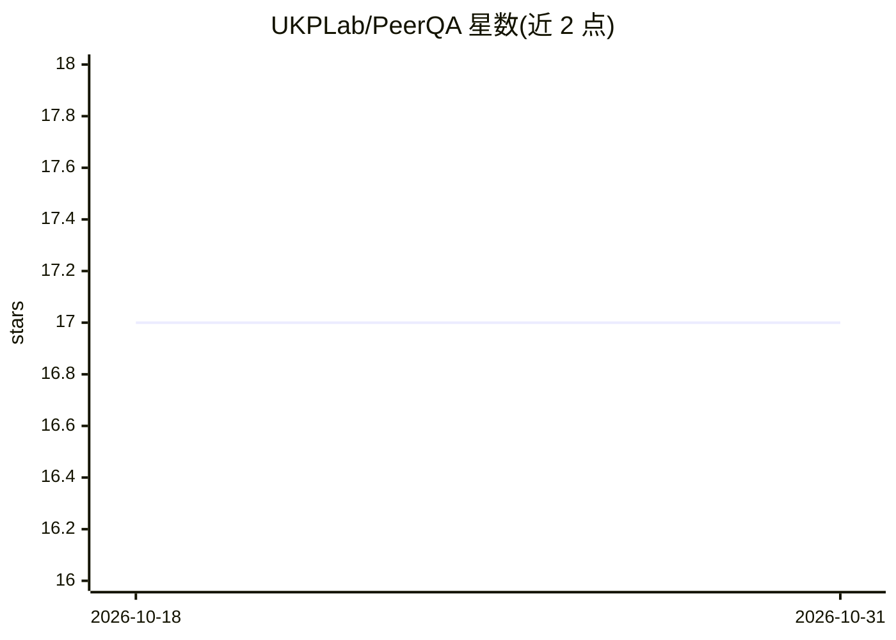

# UKPLab/PeerQA

⭐ 17 · Python · Apache-2.0 · 推送 2026-06-01 · [GitHub](https://github.com/UKPLab/PeerQA) · [官网](https://ukplab.github.io/PeerQA) · 组织维护

**源自同行评审问答的科研文档级 QA 数据集与基准**

PeerQA 是 NAACL 2025 论文的代码与数据集：从同行评审中收集审稿人提问，由论文原作者标注答案与证据，共 579 个 QA 对、208 篇学术论文，以 ML/NLP 为主并含地球科学、公共卫生等子集。支持三项任务：证据检索、不可回答问题分类、答案生成，并附 BM25/Dense/Cross-Encoder/ColBERT 检索与 LLM 生成（含 DeepSeek-R1 蒸馏模型、OpenAI 接口）的基线实验脚本。论文原文平均 12k token，构成长上下文基准；论文 PDF 因许可需自行从 OpenReview 等来源下载，经 GROBID 0.8 抽取文本。

## 筛选速览

| 维度 | 判定 | 备注 |
|---|---|---|
| AI 角色 | `ai-knowledge` | 知识聚合/清单类 |
| 许可风险 | `permissive` | Apache-2.0 |
| 部署形态 | `self-host` | docker 或自建部署 |
| 模型依赖 | — | README 未给出锁定关系 |
| 硬件要求 | — | 无带数字的原话,不猜 |
| 安装摩擦 | `low` | 无编译、无系统依赖或容器化 |
| 成熟度 | — | 结构信号不足 |

## 能力要点

- 579 个 QA 对、208 篇论文，问题来自审稿人、答案由原作者标注
- 支持证据检索、不可回答分类、答案生成三项任务的基线实验脚本
- 论文平均 12k token，作为长上下文建模基准
- 提供 Dense/Cross-Encoder/BM25/ColBERT 检索与去上下文化实验

## 适用场景

- 评测文档级证据检索与长上下文答案生成系统
- 研究不可回答问题的分类
- 复现论文中去上下文化提升检索的实验

## 场景标签

`模型评测` `科研工具` · 领域:评测与运维

## 证据(README 行号)

> L10: We present PeerQA, a real-world, scientific, document-level Question Answering (QA) dataset. PeerQA questions have 
> L11: PeerQA supports three critical tasks for developing practical QA systems: Evidence retrieval, unanswerable question

## 星数曲线

2026-10-18 17 → 2026-10-31 17（+0）

---
*卡片 v1 · prompt 1.4 · 生成 2026-10-29 · 置信度 mid · 依据 README sha `9f7e342b70ab` · [字段定义](../../DATASET.md)*
