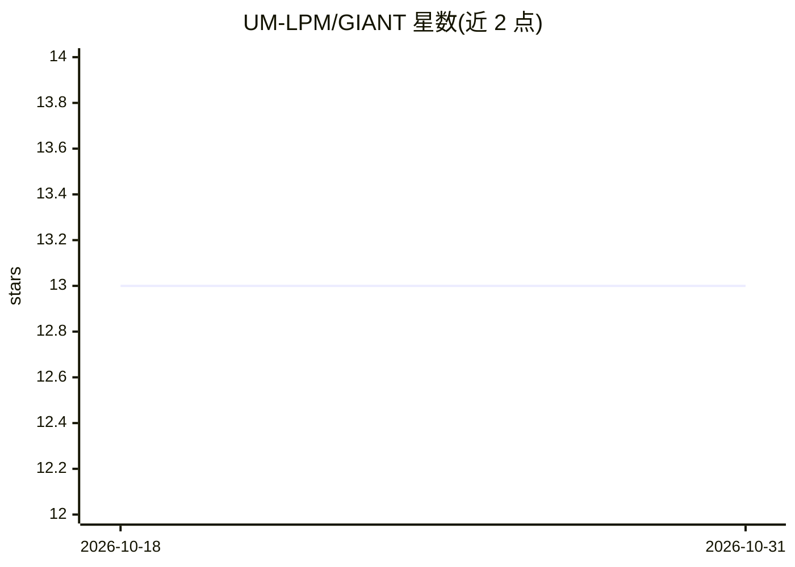

# UM-LPM/GIANT

⭐ 13 · C# · GPL-3.0 · 推送 2026-05-28 · [GitHub](https://github.com/UM-LPM/GIANT) · 组织维护

**在仿真环境中训练智能体的模块化平台，集成 Unity 与元启发式框架**

GIANT 是开源的智能体训练平台，通过集成现有方案（元启发式框架与游戏引擎）简化训练与评估流程。当前实现以 Unity 作为评估环境测试 EARS 元启发式框架生成的解，支持单/多智能体协同进化、异构个体组织、多种决策系统（行为树/神经网络/脚本/手动控制）、多级并行与七个内置示例环境。模块化结构使各组件可独立替换升级，面向研究人员与游戏开发者，发布见 Releases 页并提供引用文献。

## 筛选速览

| 维度 | 判定 | 备注 |
|---|---|---|
| AI 角色 | `ai-ecosystem` | LLM/agent 周边工具 |
| 许可风险 | `viral` | GPL-3.0 |
| 部署形态 | `desktop` | 安装包/桌面程序 |
| 模型依赖 | — | README 未给出锁定关系 |
| 硬件要求 | — | 无带数字的原话,不猜 |
| 安装摩擦 | `low` | 无编译、无系统依赖或容器化 |
| 成熟度 | — | 结构信号不足 |

## 能力要点

- 单/多智能体场景训练，支持协同进化
- 多种决策系统：BT、NN、脚本、手动控制
- Unity 作为评估环境、EARS 元启发式框架作为优化算法来源
- 七个内置示例环境作为基准，支持多级并行加速

## 适用场景

- 研究人员在仿真环境中训练并评估智能体
- 游戏开发者开发与测试 NPC 决策方案
- 对比元启发式优化算法在基准环境中的表现

## 场景标签

`多智能体` `科研工具` · 领域:Agent 开发

## 证据(README 行号)

> L1: The General Intelligent AgeNt Trainer (GIANT) is an open-source project that provides a flexible architecture for tr
> L3: The current implementation supports training with the Unity game engine and the EARS framework. Unity serves as an e
> L5: GIANT is designed with a highly modular structure, ensuring that each component operates independently and can be re

## 星数曲线

2026-10-18 13 → 2026-10-31 13（+0）

---
*卡片 v1 · prompt 1.4 · 生成 2026-10-31 · 置信度 high · 依据 README sha `1825ee150606` · [字段定义](../../DATASET.md)*
