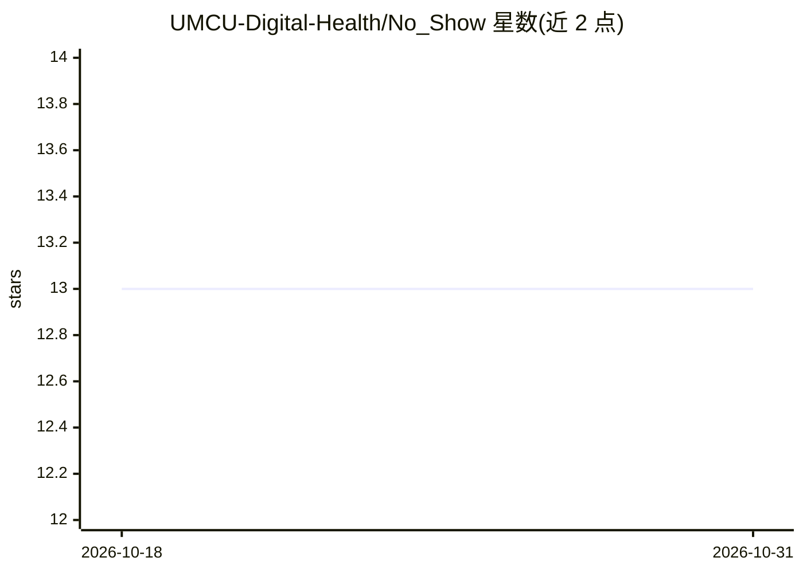

# UMCU-Digital-Health/No_Show

⭐ 13 · Python · MIT · 推送 2026-01-05 · [GitHub](https://github.com/UMCU-Digital-Health/No_Show) · [官网](https://umcu-digital-health.github.io/No_Show/) · 组织维护

**UMC Utrecht 门诊爽约预测模型，含 API 与呼叫看板**

由 UMC Utrecht AI For Health 团队开发的门诊 no-show 预测模型代码库：以 Python 实现，从数据导出到模型训练的完整流水线（train_no_show 命令），并交付两个应用——FastAPI 预测 API（每两小时运行，基于患者全部就诊历史构造特征，输出未来预约的爽约风险，且仅保留当日敏感信息）与 Streamlit 呼叫看板（按风险降序展示未来 3 个工作日预测，记录呼叫结果用于追踪与验证）。内部开发在私有仓库进行，发布时同步到本仓库；组织内复用通过 fork 方式进行。数据流编排依赖 Apache Nifi。

## 筛选速览

| 维度 | 判定 | 备注 |
|---|---|---|
| AI 角色 | `ai-native` | 本体是模型或模型工具 |
| 许可风险 | `permissive` | MIT |
| 部署形态 | `library` | 以包/库形式分发 |
| 模型依赖 | — | README 未给出锁定关系 |
| 硬件要求 | — | 无带数字的原话,不猜 |
| 安装摩擦 | `low` | 无编译、无系统依赖或容器化 |
| 成熟度 | — | 结构信号不足 |

## 能力要点

- train_no_show 一键流水线：数据导出到模型训练
- FastAPI 预测 API：基于患者完整就诊历史生成爽约风险
- 敏感信息（姓名/生日/电话）仅当日保留的数据库设计
- Streamlit 呼叫看板：按预测风险排序并避免一周内重复呼叫

## 适用场景

- 医院门诊预测哪些预约可能爽约并提前电话提醒
- 呼叫团队按风险排序安排当日呼叫名单
- 其他医疗机构 fork 后改造数据管道用于本院部署

## 场景标签

 · 领域:医疗健康/临床运营

## 证据(README 行号)

> L14: This repo contains the code for the No-Show prediction model, currently implemented at the UMC Utrecht and develope

## 星数曲线

2026-10-18 13 → 2026-10-31 13（+0）

---
*卡片 v1 · prompt 1.4 · 生成 2026-10-31 · 置信度 high · 依据 README sha `0f4da94d5221` · [字段定义](../../DATASET.md)*
