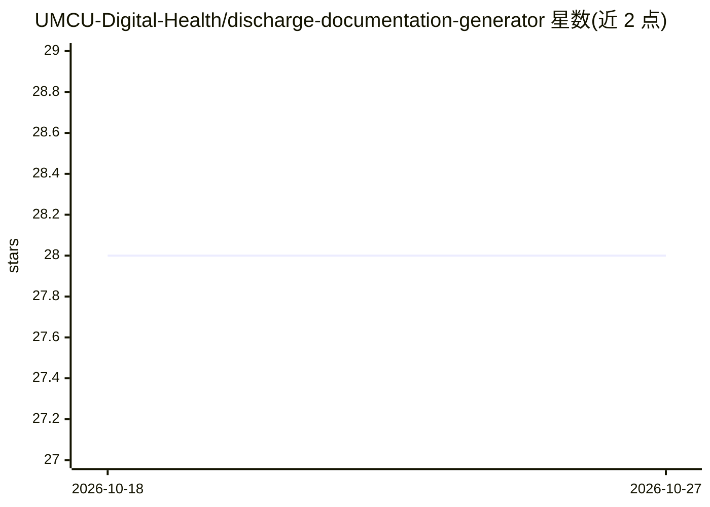

# UMCU-Digital-Health/discharge-documentation-generator

⭐ 28 · Python · MIT · 推送 2026-05-04 · [GitHub](https://github.com/UMCU-Digital-Health/discharge-documentation-generator) · [官网](https://research.umcutrecht.nl/ai-applications-in-use/) · 组织维护

**用 LLM 生成临床出院信草稿的医院工具**

UMC Utrecht 数字健康团队开发的工具：读取患者电子病历中的医疗记录，调用 LLM 生成概括住院过程的出院信草稿，覆盖重症监护室（IC）、新生儿重症监护室（NICU）与心内科（CAR）场景。定位是给医疗专业人员提供写作起点，生成的信件需由专业人员进一步修改补充后才能发送。以 Python 包（discharge_docs）形式提供，支持 pip 从源码安装、部署到 PositConnect，并提供数据管线脚本用于开发测试数据导出。公开仓库为私有仓库的镜像，仅随版本发布更新。

## 筛选速览

| 维度 | 判定 | 备注 |
|---|---|---|
| AI 角色 | `ai-native` | 本体是模型或模型工具 |
| 许可风险 | `permissive` | MIT |
| 部署形态 | `library` | 以包/库形式分发 |
| 模型依赖 | — | README 未给出锁定关系 |
| 硬件要求 | — | 无带数字的原话,不猜 |
| 安装摩擦 | `low` | 无编译、无系统依赖或容器化 |
| 成熟度 | — | 结构信号不足 |

## 能力要点

- 从电子病历医疗记录生成出院信草稿
- 面向 IC/NICU/Cardiology 三个科室场景开发
- 提供 PositConnect 部署脚本与数据管线脚本
- 附带数据卡与模型卡文档链接

## 适用场景

- 医生撰写出院信时获取草稿起点
- 医院科室批量生成出院总结初稿再人工修订

## 场景标签

`AI 写作` · 领域:内容生成

## 证据(README 行号)

> L11: The Discharge Documentation Generator is a tool that uses an LLM to generate a draft discharge letter summarizing t
> L12: Currently, the tool has been developed for the Intensive Care Unit (IC), Neonative Intensive Care Unit (NICU) and t

## 星数曲线

2026-10-18 28 → 2026-10-27 28（+0）

---
*卡片 v1 · prompt 1.4 · 生成 2026-10-26 · 置信度 mid · 依据 README sha `a98debe2a288` · [字段定义](../../DATASET.md)*
