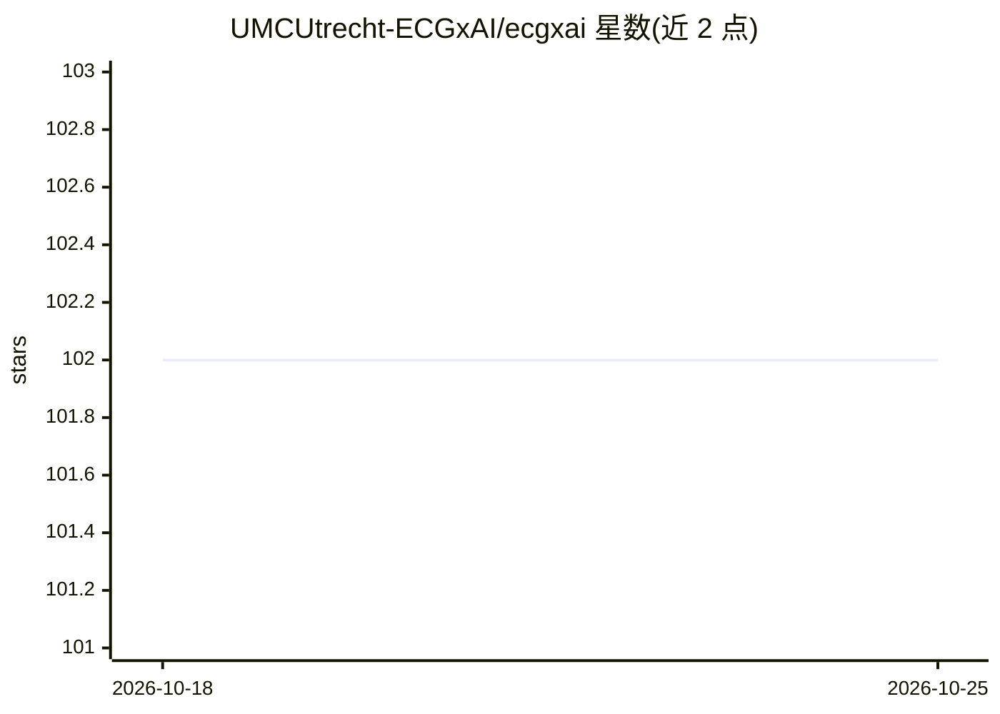

# UMCUtrecht-ECGxAI/ecgxai

⭐ 102 · Python · AGPL-3.0 · 推送 2026-07-02 · [GitHub](https://github.com/UMCUtrecht-ECGxAI/ecgxai) · 组织维护

**面向科研的 12 导联心电图可解释深度学习训练与评估 Python 库**

UMC Utrecht ECGxAI 研究组发布的可安装 Python 包，基于 PyTorch Lightning，提供训练与评估可解释 ECG 深度学习模型的功能：CausalCNN、DoubleResidual 架构，以及基于 beta 变分自编码器的 FactorECG 管线——将中位拍 ECG 压缩为 21 个可解释因子，可用于诊断或预测的统计建模。包内含面向 ECG 训练优化的工具与指标。项目自述为进行中，后续会加入更多可解释性方法。

## 筛选速览

| 维度 | 判定 | 备注 |
|---|---|---|
| AI 角色 | `ai-native` | 本体是模型或模型工具 |
| 许可风险 | `viral` | AGPL-3.0 |
| 部署形态 | `library` | 以包/库形式分发 |
| 模型依赖 | — | README 未给出锁定关系 |
| 硬件要求 | — | 无带数字的原话,不猜 |
| 安装摩擦 | `low` | 无编译、无系统依赖或容器化 |
| 成熟度 | `idea` | |

## 能力要点

- 提供 CausalCNN、DoubleResidual、FactorECG（beta VAE）三种架构的训练功能
- FactorECG 将中位拍 ECG 编码为 21 个可解释因子，可交互式重建/生成 ECG
- 基于 PyTorch Lightning，附带 ECG 训练优化工具与指标
- 提供监督分类与 VAE 训练的示例代码

## 适用场景

- 训练可解释的 12 导联 ECG 分类/诊断模型
- 将 ECG 编码为 21 因子后用统计模型做诊断或预测
- 复现论文中的 CausalCNN / DoubleResidual / FactorECG 实验

## 场景标签

`科研工具` · 领域:学习与行业

## 证据(README 行号)

> L9: This repository accompanies papers from the *Explainable AI for the ECG (ECGxAI)* research group at the UMC Utrecht 
> L11: The first version of this package provides functionalities to train the CausalCNN architecture as proposed in our C
> L16: The ECG can be compressed into 21 significant factors, that allow for reconstruction of the full median beat ECG. T

## 星数曲线

2026-10-18 102 → 2026-10-25 102（+0）

---
*卡片 v1 · prompt 1.4 · 生成 2026-10-23 · 置信度 high · 依据 README sha `0d7844e04c20` · [字段定义](../../DATASET.md)*
