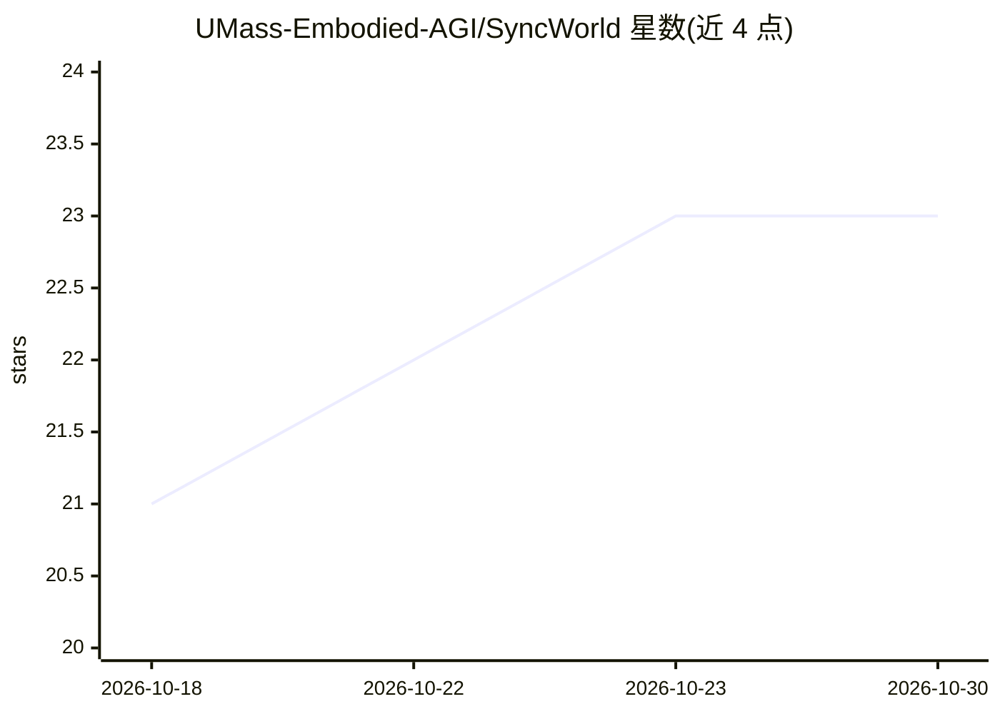

# UMass-Embodied-AGI/SyncWorld

⭐ 23 · Python · NOASSERTION · 推送 2026-09-10 · [GitHub](https://github.com/UMass-Embodied-AGI/SyncWorld) · [官网](https://umass-embodied-agi.github.io/SyncWorld/) · 组织维护

**视觉校准世界模型：单一检查点零样本充当未见过环境的模拟器**

NeurIPS 2026 论文 SyncWorld 的训练与评测代码，源自 NVIDIA Cosmos-Framework，基于公开 Cosmos3-Nano 检查点训练。机制上以短视觉校准片段（配对帧与动作）作为上下文提示，在推理时推断部署环境特有的动作—视觉映射，无需针对新环境微调即可零样本 rollout 生成未来视频帧。提供分布式 FSDP 训练（TOML 配方、DCP 检查点、safetensors 导入导出）与按 PSNR/SSIM/LPIPS 打分的整回合评测脚本，权重与评测集发布于 HuggingFace。要求 Linux、Ampere 及以上 NVIDIA GPU、CUDA ≥ 12.8、约 60 GB 磁盘。

## 筛选速览

| 维度 | 判定 | 备注 |
|---|---|---|
| AI 角色 | `ai-native` | 本体是模型或模型工具 |
| 许可风险 | `none` | NOASSERTION |
| 部署形态 | `library` | 以包/库形式分发 |
| 模型依赖 | — | README 未给出锁定关系 |
| 硬件要求 | — | 无带数字的原话,不猜 |
| 安装摩擦 | `medium` | 含编译或系统依赖之一 |
| 成熟度 | — | 结构信号不足 |

## 能力要点

- 视觉校准片段作为 in-context 提示，单一检查点零样本适配新环境/新机体
- 评测脚本按回合自回归 rollout 并输出 PSNR/SSIM/LPIPS 指标与 GT 对照视频
- 分布式 FSDP 训练器，typed TOML 配方与 uv.lock 固定的双层环境
- 支持无校准的 history-only 条件与延长生成轮数设置

## 适用场景

- 在 ManiSkill/LIBERO 或自录数据上评测世界模型的 rollout 保真度
- 从 Cosmos3-Nano 基座继续训练前向/逆向动力学世界模型
- 研究跨相机、机器人放置与机体的动作—视觉映射泛化

## 场景标签

`视频生成` `微调` · 领域:内容生成

## 证据(README 行号)

> L25: **SyncWorld brings in-context learning to this problem.** Instead of fine-tuning per deployment, it
> L29: demonstration rather than baked into the weights, so a single checkpoint acts as a **zero-shot
> L35: - **Evaluation** — full-episode autoregressive rollout scored with PSNR / SSIM /

## 星数曲线

2026-10-18 21 → 2026-10-30 23（+2）

---
*卡片 v1 · prompt 1.4 · 生成 2026-10-27 · 置信度 mid · 依据 README sha `46f9d5857a4f` · [字段定义](../../DATASET.md)*
