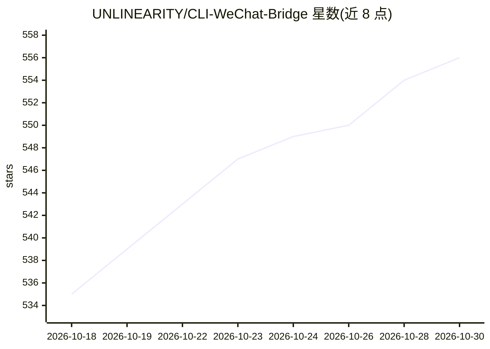

# UNLINEARITY/CLI-WeChat-Bridge

⭐ 556 · TypeScript · AGPL-3.0 · 推送 2026-10-25 · [GitHub](https://github.com/UNLINEARITY/CLI-WeChat-Bridge) · [官网](https://unlinearity.github.io/CLI-WeChat-Bridge/) · 个人维护 · 中文 README

**把微信/企业微信/Telegram 桥接到本地 AI CLI 的远程入口工具**

面向在本地终端使用 Codex、Claude Code、OpenCode、Pi 等 AI CLI 的开发者：将这些消息通道桥接到本地会话，实现远程输入、结果回流、审批请求与状态同步，保留本地原生终端体验。提供渐进桥接（单桥接→多 CLI→多实例→多目录）、常驻 daemon 多 CLI 切换、文件传输与操作者配对机制。通过 npm 全局安装，依赖 Node.js >= 22.13.0；Linux 需编译工具链构建 node-pty，Claude Code 适配器依赖 PTY 模式，node-pty 不可用时回退兼容模式可能无法正常桥接 Claude Code。

## 筛选速览

| 维度 | 判定 | 备注 |
|---|---|---|
| AI 角色 | `ai-ecosystem` | LLM/agent 周边工具 |
| 许可风险 | `viral` | AGPL-3.0 |
| 部署形态 | `library` | 以包/库形式分发 |
| 模型依赖 | — | README 未给出锁定关系 |
| 硬件要求 | — | 无带数字的原话,不猜 |
| 安装摩擦 | `medium` | 含编译或系统依赖之一 |
| 成熟度 | — | 结构信号不足 |

## 能力要点

- 微信/企业微信/Telegram 三通道接入四种本地 AI CLI
- 渐进桥接模式：L0 单桥接到 L3 多目录逐级扩展
- 常驻 daemon 支持远程多 CLI 切换与多工作目录管理
- 企业微信/Telegram 均用长连接/长轮询，不需要公网回调地址

## 适用场景

- 离开电脑后通过微信或 Telegram 向本地 Codex/Claude Code 会话发任务
- 在多个本地 AI CLI 和多项目目录间远程切换
- 远程接收审批请求并同步 CLI 运行状态
- 通过聊天通道向本地 CLI 传输文件供模型解析

## 场景标签

`编码 Agent` · 领域:编码与开发

## 证据(README 行号)

> L17: **命令行工具的微信、企业微信与 Telegram 桥接**：本项目将微信、企业微信或 Telegram 消息桥接到本地运行的 `Codex`、`Claude Code`、`OpenCode` 和 `Pi`，同时把本地输出、审批请
> L19: 项目围绕本地工作流设计，重点是保留**本地原生终端体验**：你仍然在本地使用原生 CLI 和高级启动参数，微信、企业微信或 Telegram 负责远程输入、结果回流与状态同步。

## 星数曲线

2026-10-18 535 → 2026-10-30 556（+21）

---
*卡片 v1 · prompt 1.4 · 生成 2026-10-21 · 置信度 high · 依据 README sha `74697ed01278` · [字段定义](../../DATASET.md)*
