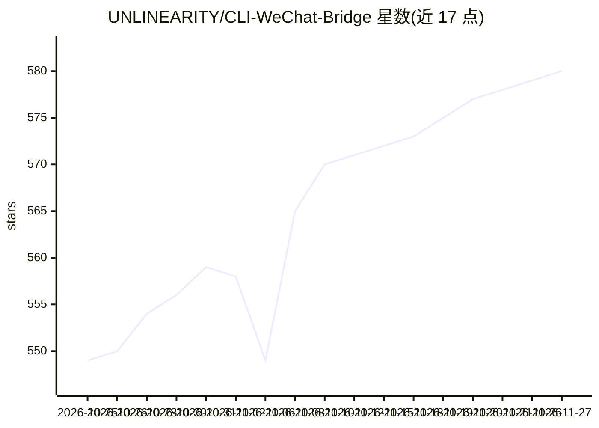

# UNLINEARITY/CLI-WeChat-Bridge

⭐ 580 · TypeScript · AGPL-3.0 · 推送 2026-11-22 · [GitHub](https://github.com/UNLINEARITY/CLI-WeChat-Bridge) · [官网](https://unlinearity.github.io/CLI-WeChat-Bridge/) · 个人维护 · 中文 README

**把微信/企业微信/Telegram 桥接到本地 Codex、Claude Code 等终端 CLI**

一个 npm 全局安装的桥接工具：将微信、企业微信或 Telegram 消息转发到本地运行的 Codex、Claude Code、OpenCode、Pi 四种终端 CLI，并把输出、审批请求与运行状态同步回聊天通道。本地 CLI 保持主工作界面与原生启动参数，聊天软件仅作远程入口。支持 L0–L3 渐进桥接（多 CLI、同 CLI 多实例、多目录）、远程切换指令、双向文件传输、常驻 daemon 与操作者配对。要求 Node.js ≥22.13.0；Claude Code 适配器依赖 node-pty，Linux 需编译工具链。

## 筛选速览

| 维度 | 判定 | 备注 |
|---|---|---|
| AI 角色 | `ai-ecosystem` | LLM/agent 周边工具 |
| 许可风险 | `viral` | AGPL-3.0 |
| 部署形态 | `library` | 以包/库形式分发 |
| 模型依赖 | — | README 未给出锁定关系 |
| 硬件要求 | — | 无带数字的原话,不猜 |
| 安装摩擦 | `medium` | 含编译或系统依赖之一 |
| 成熟度 | — | 结构信号不足 |

## 能力要点

- 桥接微信、企业微信、Telegram 到 4 种本地 CLI，保留原生终端体验
- L0–L3 渐进桥接：多 CLI、多实例、多目录切换（/codex、/claude、/cd 等）
- 双向文件传输与审批请求、状态同步
- wecom/telegram 使用官方长连接/长轮询，不需公网回调地址

## 适用场景

- 离开电脑后通过微信向本地 Codex 会话发任务并收结果
- 一个 Telegram 机器人在多个项目目录间切换管理多个 CLI 会话
- 远程给本地 Claude Code 传输文件并审批执行请求

## 场景标签

`编码 Agent` · 领域:编码与开发

## 证据(README 行号)

> L17: **命令行工具的微信、企业微信与 Telegram 桥接**：本项目将微信、企业微信或 Telegram 消息桥接到本地运行的 `Codex`、`Claude Code`、`OpenCode` 和 `Pi`，同时把本地输出、审批请
> L19: 项目围绕本地工作流设计，重点是保留**本地原生终端体验**：你仍然在本地使用原生 CLI 和高级启动参数，微信、企业微信或 Telegram 负责远程输入、结果回流与状态同步。
> L43: - **微信、企业微信或 Telegram 是远程入口**，用来接入本地会话；

## 星数曲线

2026-10-25 549 → 2026-11-27 580（+31）

---
*卡片 v1 · prompt 1.4 · 生成 2026-11-25 · 置信度 high · 依据 README sha `84dd53a2be70` · [字段定义](../../DATASET.md)*
