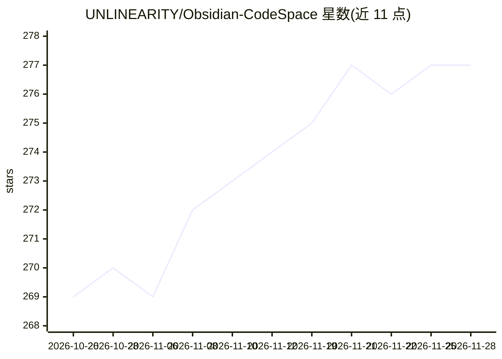

# UNLINEARITY/Obsidian-CodeSpace

⭐ 277 · TypeScript · AGPL-3.0 · 推送 2026-11-23 · [GitHub](https://github.com/UNLINEARITY/Obsidian-CodeSpace) · 个人维护 · 中文 README

**Obsidian 代码文件管理插件：索引、查看、编辑与嵌入代码**

Obsidian 社区插件，弥补其原生以 Markdown 为中心对代码文件支持的不足。提供五层功能：代码文件的统一索引与可视化仪表盘、基于 CodeMirror 6 的语法高亮编辑与结构化导航、Markdown 中按行范围嵌入代码并支持原生 PDF 导出为代码块、通过 symlink/junction 挂载外部文件夹进行跨 Vault 管理（仅桌面端），以及基于 xterm.js 与 node-pty 的系统集成终端（仅桌面端，需手动下载平台辅助包）。通过 Obsidian 官方社区插件目录安装。

## 筛选速览

| 维度 | 判定 | 备注 |
|---|---|---|
| AI 角色 | `ai-enhanced` | 去掉 AI 部分产品仍成立 |
| 许可风险 | `viral` | AGPL-3.0 |
| 部署形态 | `desktop` | 安装包/桌面程序 |
| 模型依赖 | — | README 未给出锁定关系 |
| 硬件要求 | — | 无带数字的原话,不猜 |
| 安装摩擦 | `low` | 无编译、无系统依赖或容器化 |
| 成熟度 | — | 结构信号不足 |

## 能力要点

- 代码文件可视化仪表盘：按文件夹/扩展名过滤、搜索与排序
- CodeMirror 6 语法高亮编辑器，支持类/函数大纲点击跳转
- Markdown 嵌入代码支持行范围语法（含 GitHub 风格 L 前缀）
- 基于 node-pty 的真实系统终端（PowerShell/zsh/bash），桌面端可用

## 适用场景

- 在 Obsidian 库内集中浏览和管理代码文件
- 笔记中嵌入代码片段并导出为带真实代码块的 PDF
- 不复制代码进 Vault 直接管理外部项目目录
- 编辑代码时随手调用系统终端运行命令

## 场景标签

 · 领域:知识管理/开发工具

## 证据(README 行号)

> L31: Obsidian's native workflow is centered on Markdown notes, so its support for centralized code file browsing, manage
> L55: - **Syntax highlighting**: Powered by CodeMirror 6 with accurate highlighting for many languages.
> L39: 5. **Terminal space**: Run a real system shell (PowerShell, zsh, bash) inside the editor, on desktop.

## 星数曲线

2026-10-26 269 → 2026-11-28 277（+8）

---
*卡片 v1 · prompt 1.4 · 生成 2026-11-25 · 置信度 low · 依据 README sha `747e98f6820a` · [字段定义](../../DATASET.md)*
