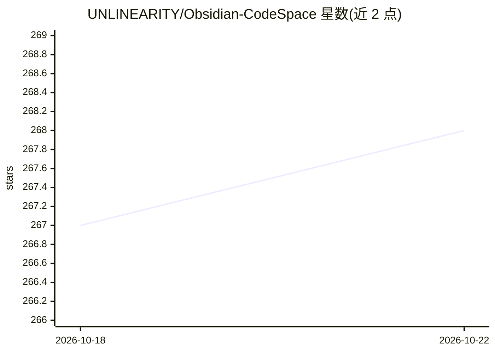

# UNLINEARITY/Obsidian-CodeSpace

⭐ 269 · TypeScript · AGPL-3.0 · 推送 2026-10-19 · [GitHub](https://github.com/UNLINEARITY/Obsidian-CodeSpace) · 个人维护 · 中文 README

**Obsidian 代码文件管理插件：索引、编辑、嵌入、外部挂载与终端**

面向 Obsidian 用户的社区插件，补足其以 Markdown 为中心的工作流中对代码文件的集中管理能力。提供可视化仪表盘统一索引与管理 Vault 内代码文件；基于 CodeMirror 6 的语法高亮编辑环境（结构导航、正则搜索替换、代码折叠）；在 Markdown 中以 ![[file#L20-40]] 语法嵌入代码片段并支持原生 PDF 导出为真实代码块；通过 symlink/junction 将 Vault 外部文件夹挂载进库（仅桌面端）；集成基于 xterm.js 与 node-pty 的真实系统终端（默认关闭，需手动下载平台支持包）。已上架官方社区插件目录。README 本身未描述 AI 功能，仅仓库主题标签含 ai/claude/codex。

## 筛选速览

| 维度 | 判定 | 备注 |
|---|---|---|
| AI 角色 | `ai-enhanced` | 去掉 AI 部分产品仍成立 |
| 许可风险 | `viral` | AGPL-3.0 |
| 部署形态 | `desktop` | 安装包/桌面程序 |
| 模型依赖 | — | README 未给出锁定关系 |
| 硬件要求 | — | 无带数字的原话,不猜 |
| 安装摩擦 | `low` | 无编译、无系统依赖或容器化 |
| 成熟度 | — | 结构信号不足 |

## 能力要点

- 可视化仪表盘统一索引、筛选与管理代码文件
- CodeMirror 6 语法高亮编辑与代码结构导航（类/函数点击跳转）
- Markdown 中按行范围嵌入代码片段，PDF 导出为真实代码块
- symlink/junction 外部文件夹挂载与真实 PTY 系统终端（均仅桌面端）

## 适用场景

- 在 Obsidian 内集中浏览、编辑和管理散落的代码文件
- 在笔记中引用并嵌入代码文件的指定行片段
- 跨项目工作时挂载外部代码仓库目录直接管理
- 在编辑器内直接运行系统终端执行命令

## 场景标签

 · 领域:笔记/开发工具

## 证据(README 行号)

> L3:  Professional code file support for Obsidian
> L28: Obsidian's native workflow is centered on Markdown notes, so its support for centralized code file browsing, manage

## 星数曲线

2026-10-18 267 → 2026-10-22 268（+1）

---
*卡片 v1 · prompt 1.4 · 生成 2026-10-22 · 置信度 low · 依据 README sha `f975fa0a7f14` · [字段定义](../../DATASET.md)*
