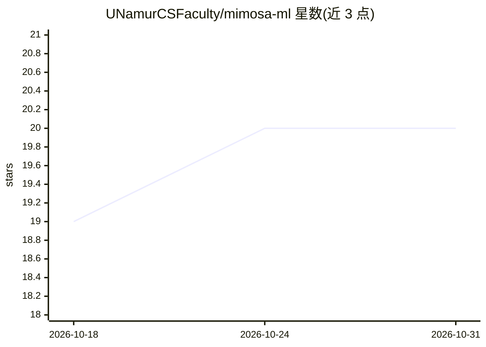

# UNamurCSFaculty/mimosa-ml

⭐ 20 · Python · MIT · 推送 2026-09-30 · [GitHub](https://github.com/UNamurCSFaculty/mimosa-ml) · [官网](https://mimosa-ml.readthedocs.io/en/latest/) · 组织维护

**面向函数型数据分析的多任务高斯过程框架**

基于 MagmaClust 增强改造的多任务高斯过程（GP）Python 框架，用于分析函数型/序列数据：支持多任务联合学习（采样网格无需对齐）、样本聚类、多维输入输出、输出间相关性学习与不确定性量化的概率预测。以 JAX/Equinox 为后端，通过 jit/vmap/grad 与 XLA 支持 GPU/TPU 训练预测，核函数依赖 Kernax 包，含 Deep Kernax 集成。非高斯数据可经 Laplace 近似转为伪观测（实验性）。项目处于早期开发阶段，API 可能变动，建议版本锁定。由高校研究人员组成的 Magma Task Force 维护，MIT 许可。

## 筛选速览

| 维度 | 判定 | 备注 |
|---|---|---|
| AI 角色 | `ai-native` | 本体是模型或模型工具 |
| 许可风险 | `permissive` | MIT |
| 部署形态 | `library` | 以包/库形式分发 |
| 模型依赖 | — | README 未给出锁定关系 |
| 硬件要求 | — | 无带数字的原话,不猜 |
| 安装摩擦 | `low` | 无编译、无系统依赖或容器化 |
| 成熟度 | `idea` | |

## 能力要点

- 多任务 GP 联合学习，支持未对齐采样网格与样本聚类
- 多维输入/输出与输出间相关性学习，预测附不确定性量化
- JAX/Equinox 全兼容（vmap/grad/jit），支持 GPU/TPU 训练预测
- 非高斯观测（二项/计数）可 Laplace 近似接入（实验性）

## 适用场景

- 多个体/多样本的函数型数据建模与预测
- 聚类发现样本群体结构并做带不确定性的预测
- 向量值函数的输出间相关性学习

## 场景标签

 · 领域:机器学习/贝叶斯时序建模

## 证据(README 行号)

> L5: A fully-featured *multi-task Gaussian process framework* for analysing functional data.
> L13: * Probabilistic predictions with uncertainty quantification
> L16: * Support for training and predicting on GPUs and TPUs

## 星数曲线

2026-10-18 19 → 2026-10-31 20（+1）

---
*卡片 v1 · prompt 1.4 · 生成 2026-10-28 · 置信度 high · 依据 README sha `b09aab6bd926` · [字段定义](../../DATASET.md)*
