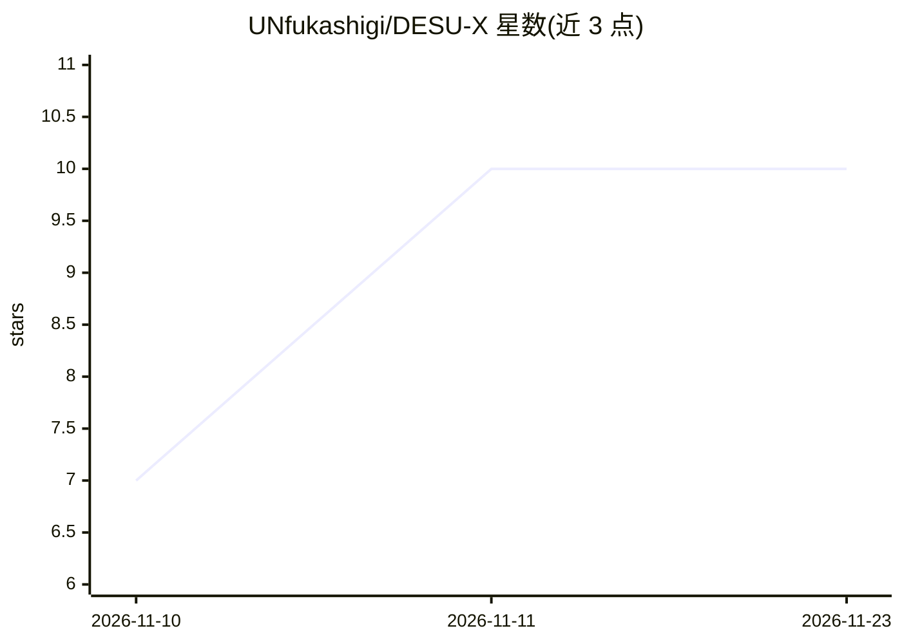

# UNfukashigi/DESU-X

⭐ 10 · JavaScript · GPL-3.0 · 推送 2026-11-10 · [GitHub](https://github.com/UNfukashigi/DESU-X) · [官网](https://fukachan.jp/) · 个人维护

**加载 AI 生成漫画 JSON 后手工精修的浏览器漫画编辑器**

基于 new-sankaku 的 Manga Editor Desu! Pro Edition 改造的 GPL-3.0 漫画编辑器：读取 AI 生成的 DESU-X JSON（或含图片的 ZIP），在画布上手工完成分格、对话框与竖排台词的调整，并可将修改以 JSON 或 ZIP 导出回流给 AI 继续改稿。相比原版增加图层文件夹/面板、文字编辑与误操作防护，并移除了画面内的 AI 生成功能。下载 ZIP 解压后用浏览器打开 index.html 即可运行，无需安装或 Python；作者声明为个人自用工具公开，不提供支持。

## 筛选速览

| 维度 | 判定 | 备注 |
|---|---|---|
| AI 角色 | `ai-enhanced` | 去掉 AI 部分产品仍成立 |
| 许可风险 | `viral` | GPL-3.0 |
| 部署形态 | `None` |  |
| 模型依赖 | — | README 未给出锁定关系 |
| 硬件要求 | — | 无带数字的原话,不猜 |
| 安装摩擦 | `low` | 无编译、无系统依赖或容器化 |
| 成熟度 | `idea` | |

## 能力要点

- 读取/导出 AI 可用的 DESU-X JSON 与含图 ZIP，并附 JSON 规格书供 AI 阅读
- 图层文件夹、锁定、按分格分组等图层管理功能
- 解压即用：浏览器打开 index.html 运行，无安装步骤
- 附带 AGENTS.md / CLAUDE.md 供 AI agent 引导使用

## 适用场景

- 让 AI 生成漫画 JSON 后，手工精修分格与台词再导出成图
- 把改好的 JSON 交回 AI 继续润色台词
- 在浏览器中离线编辑漫画版式与图层

## 场景标签

`图像生成` `图像视频处理` · 领域:内容生成

## 证据(README 行号)

> L3: **DESU-X** は、new-sankaku さんの漫画エディタ **Manga Editor Desu! Pro Edition** をもとに改造した漫画エディタです。
> L60: - **AI 生成機能を画面から外した**
> L16: 2. 展開したフォルダの **`index.html` をブラウザ（Chrome 推奨）で開く**。これだけで使えます（インストール不要、Python なども不要）。

## 星数曲线

2026-11-10 7 → 2026-11-23 10（+3）

---
*卡片 v1 · prompt 1.4 · 生成 2026-11-20 · 置信度 high · 依据 README sha `c1245081e9c9` · [字段定义](../../DATASET.md)*
