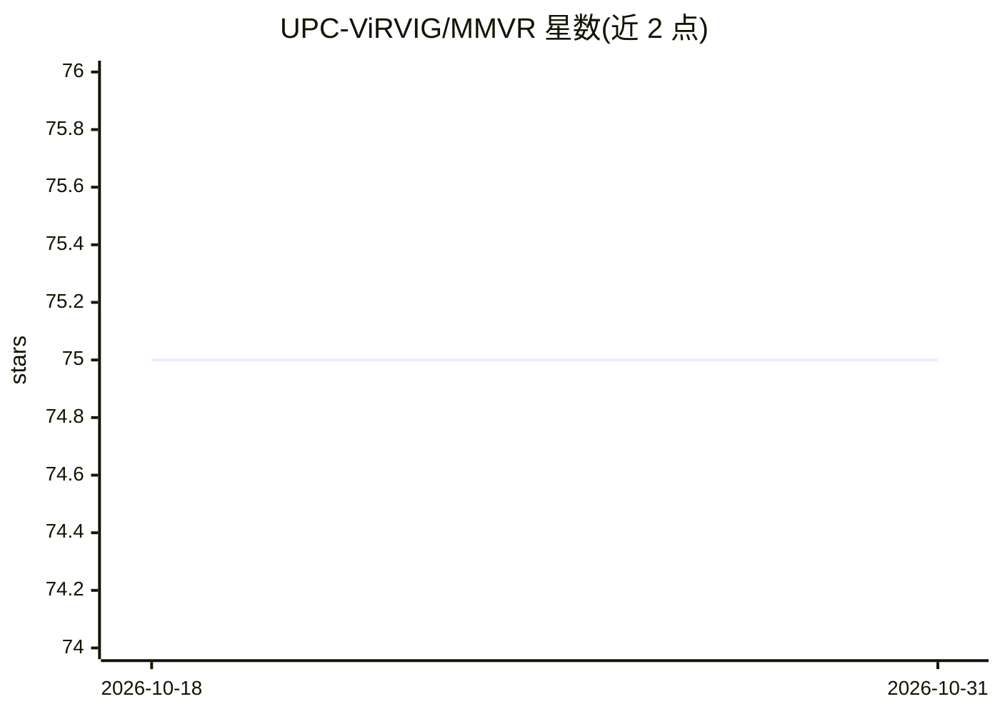

# UPC-ViRVIG/MMVR

⭐ 75 · C# · NOASSERTION · 推送 2026-06-06 · [GitHub](https://github.com/UPC-ViRVIG/MMVR) · [官网](https://upc-virvig.github.io/MMVR/) · 组织维护

**面向消费级 VR 设备的全身 Avatar 动画方法实现（SCA 2022 论文）**

SCA 2022 论文《Combining Motion Matching and Orientation Prediction to Animate Avatars for Consumer-Grade VR Devices》的官方实现：在 Unity 中以 Motion Matching 驱动下身动画，用 PyTorch 训练的方向预测网络估计身体朝向，上身由 FinalIK 做逆运动学。包含 Unity 项目、Python 训练脚本、处理好的数据集与 BVH 原始动捕数据（同一演员在 Meta Quest 与 HTC VIVE 上录制）。需 Unity 2021.2.13f1，FinalIK 需 Unity Asset Store 有效许可，许可为 CC BY-NC-SA 4.0（禁止商用）。

## 筛选速览

| 维度 | 判定 | 备注 |
|---|---|---|
| AI 角色 | `ai-native` | 本体是模型或模型工具 |
| 许可风险 | `none` | NOASSERTION |
| 部署形态 | `library` | 以包/库形式分发 |
| 模型依赖 | — | README 未给出锁定关系 |
| 硬件要求 | — | 无带数字的原话,不猜 |
| 安装摩擦 | `low` | 无编译、无系统依赖或容器化 |
| 成熟度 | — | 结构信号不足 |

## 能力要点

- Motion Matching + 神经网络方向预测组合驱动 VR Avatar
- 上身 IK 用 FinalIK，支持 HMD-only 模式与腿部弯曲标定
- 提供 BVH 数据集（Quest 与 VIVE 录制）与 PyTorch 训练脚本

## 适用场景

- 复现论文的 VR 全身 Avatar 动画方法
- 用自录动画数据训练方向预测网络
- 在 Meta Quest 上以 HMD 输入生成全身动画

## 场景标签

 · 领域:计算机图形学/虚拟现实

## 证据(README 行号)

> L9: This repository contains the implementation of the method shown in the paper *Combining Motion Matching and Orientat
> L25: The project is divided into two folders, ``MMVR`` and ``python``, containing the Unity project and orientation pred

## 星数曲线

2026-10-18 75 → 2026-10-31 75（+0）

---
*卡片 v1 · prompt 1.4 · 生成 2026-10-24 · 置信度 mid · 依据 README sha `02f1f88d6387` · [字段定义](../../DATASET.md)*
