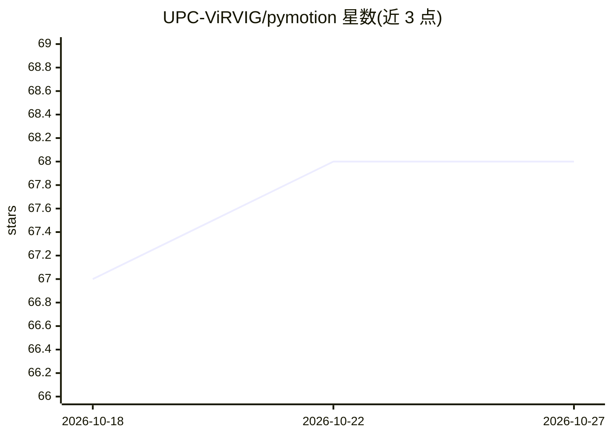

# UPC-ViRVIG/pymotion

⭐ 68 · Python · MIT · 推送 2026-06-19 · [GitHub](https://github.com/UPC-ViRVIG/pymotion) · 组织维护

**面向角色动画神经网络的动作数据处理 Python 库**

提供 NumPy 与 PyTorch 双实现的动作数据处理函数：四元数运算及与旋转矩阵、轴角、欧拉角、6D 表示的相互转换，用于刚性位移的对偶四元数表示，BVH 文件读取与预处理，正向运动学等骨骼运算，动画镜像操作，以及与 Blender 的自动通信用于调试可视化。面向开发角色动画神经网络的开发者，通过 pip 安装。原 plotly 可视化器已标记弃用。

## 筛选速览

| 维度 | 判定 | 备注 |
|---|---|---|
| AI 角色 | `ai-ecosystem` | LLM/agent 周边工具 |
| 许可风险 | `permissive` | MIT |
| 部署形态 | `library` | 以包/库形式分发 |
| 模型依赖 | — | README 未给出锁定关系 |
| 硬件要求 | — | 无带数字的原话,不猜 |
| 安装摩擦 | `low` | 无编译、无系统依赖或容器化 |
| 成熟度 | — | 结构信号不足 |

## 能力要点

- 四元数与旋转矩阵/轴角/欧拉/6D 表示的相互转换
- 对偶四元数刚性位移表示与连续 6D 旋转表示
- BVH 读取与正向运动学等骨骼运算
- PyMotion 到 Blender 的自动通信可视化

## 适用场景

- 为角色动画神经网络准备和处理 BVH 动作数据
- 在训练中将关节旋转转换为网络友好的 6D/对偶四元数表示
- 在 Blender 中调试和可视化角色动画

## 场景标签

 · 领域:计算机图形学/角色动画

## 证据(README 行号)

> L3: PyMotion is a Python library that provides various functions for manipulating and processing motion data in NumPy or
> L8: - A dual quaternion representation for rigid displacements, which can help neural networks better understand poses, 
> L9: - A continuous 6D rotation representation, as introduced by [Zhou et al. [2019]](https://doi.org/10.1109/CVPR.2019.0

## 星数曲线

2026-10-18 67 → 2026-10-27 68（+1）

---
*卡片 v1 · prompt 1.4 · 生成 2026-10-24 · 置信度 high · 依据 README sha `1c82e4fe7e65` · [字段定义](../../DATASET.md)*
