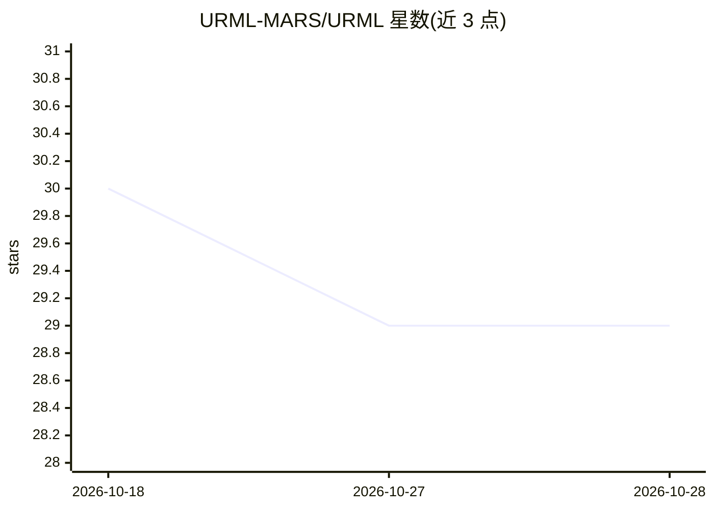

# URML-MARS/URML

⭐ 29 · Python · Apache-2.0 · 推送 2026-10-26 · [GitHub](https://github.com/URML-MARS/URML) · [官网](https://www.urml.dev) · 个人维护

**机器人意图描述语言：规范、校验器与参考运行时**

URML 是一种描述机器人意图的开放语言规范，附带参考实现：六趟静态校验器（参数类型→能力→安全包络→变量绑定→合规策略）、LLM 翻译桥（Anthropic/OpenAI/Ollama/llama.cpp 均为一等支持）、269 条一致性测试夹具与 20 余个参考运行时（ROS 2、PX4/MAVLink、ArduPilot、OPC UA、多品牌机械臂、仿真器等）。程序在执行前先对照机器人声明的能力与安全包络校验，不合规命令在纸面上被拒绝。供机器人开发者在 ROS 2、PX4 等系统之上统一意图表达。v0.1.0，作者为唯一维护者。

## 筛选速览

| 维度 | 判定 | 备注 |
|---|---|---|
| AI 角色 | `ai-ecosystem` | LLM/agent 周边工具 |
| 许可风险 | `permissive` | Apache-2.0 |
| 部署形态 | `library` | 以包/库形式分发 |
| 模型依赖 | local-ok | 支持本地模型 |
| 硬件要求 | — | 无带数字的原话,不猜 |
| 安装摩擦 | `low` | 无编译、无系统依赖或容器化 |
| 成熟度 | `idea` | |

## 能力要点

- 六趟静态校验：任何执行前拒绝超出能力/安全包络的命令
- LLM 桥为 provider 无关（Anthropic/OpenAI/Ollama/llama.cpp CLI 一等支持），含修正循环与 whisper.cpp 语音前端
- 24 个原语及全部验证器+参考运行时执行器；269 条一致性夹具，9 个 CLI 子命令
- 26+ 参考运行时覆盖 ROS 2、PX4、ArduPilot、16 品牌工业臂、OPC UA、仿真器等

## 适用场景

- 让 LLM 生成的机器人指令先经静态校验再执行
- 跨 ROS 2 / PX4 / 机械臂等不同底层用同一意图语言编程
- 按 US 联邦合规策略（NDAA §889/FCC 等）校验机器人程序并可自定义策略
- 用 CLI 三条命令在无机器人环境验证 URML 程序

## 场景标签

 · 领域:机器人软件/规范与工具链

## 证据(README 行号)

> L78: |**LLM bridge** — provider-agnostic (Anthropic + OpenAI + Ollama + llama.cpp + EchoProvider, all first-class in the
> L110: │  LLM bridge: provider-agnostic, prompt contract, revision loop    │
> L22: URML is a **specification** and a set of **reference implementations**, not a robot operating system. The specifica

## 星数曲线

2026-10-18 30 → 2026-10-28 29（-1）

---
*卡片 v1 · prompt 1.4 · 生成 2026-10-26 · 置信度 high · 依据 README sha `007e31ee71b7` · [字段定义](../../DATASET.md)*
