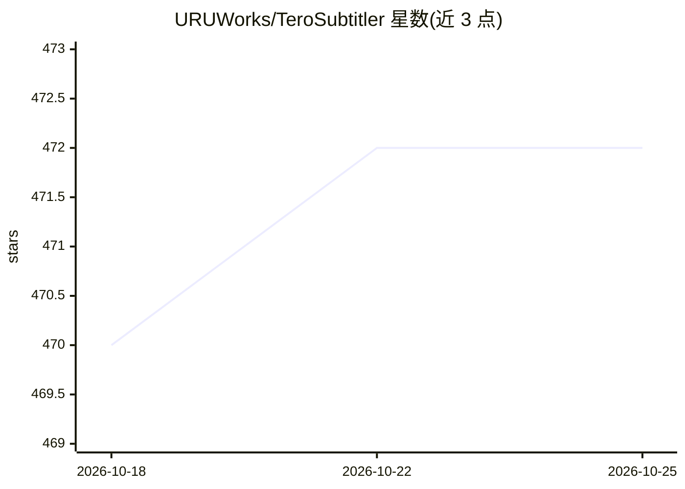

# URUWorks/TeroSubtitler

⭐ 472 · Pascal · MPL-2.0 · 推送 2026-09-19 · [GitHub](https://github.com/URUWorks/TeroSubtitler) · [官网](https://uruworks.net) · 组织维护

**跨平台开源字幕编辑软件，含自动转录与翻译**

面向字幕制作与校对用户的开源跨平台字幕编辑器（MPL 2.0），支持 SMPTE 与 Media 两种时码模式、多种字幕格式、波形时间线、音频视频预览、Blu-ray SUP 导入导出、翻译记忆与质量校验等。集成了 mpv 播放引擎、FFmpeg、yt-dlp、whisper.cpp/Faster-Whisper（自动转录）、Google Translate（自动翻译）、ElevenLabs TTS（视频配音）与 Tesseract OCR。源码通过 Lazarus IDE 编译，依赖多个内部与外部 Lazarus 包。项目前身是 URUWorks 的 Subtitle Workshop，原仓库已由 Tero Subtitler 取代。

## 筛选速览

| 维度 | 判定 | 备注 |
|---|---|---|
| AI 角色 | `ai-enhanced` | 去掉 AI 部分产品仍成立 |
| 许可风险 | `permissive` | MPL-2.0 |
| 部署形态 | `None` |  |
| 模型依赖 | — | README 未给出锁定关系 |
| 硬件要求 | — | 无带数字的原话,不猜 |
| 安装摩擦 | `medium` | 含编译或系统依赖之一 |
| 成熟度 | — | 结构信号不足 |

## 能力要点

- SMPTE/Media 双模式的全功能字幕编辑与多级撤销、自动备份
- whisper.cpp/Faster-Whisper 驱动的音频自动转录为字幕
- 自动翻译（Google Translate）与视频配音（ElevenLabs TTS）
- Blu-ray SUP 导入导出、波形时间线、拼写检查与行业校验配置

## 适用场景

- 制作与校对各类格式的字幕文件
- 把音频/视频自动转录生成字幕再人工修正
- 将字幕翻译到其他语言并利用翻译记忆保持一致
- 导入 Blu-ray SUP 图形字幕进行编辑或转换

## 场景标签

`语音识别` `语音合成` `OCR` · 领域:内容生成

## 证据(README 行号)

> L20: - Source and Transcription modes
> L24: - Tools for manipulation (frame/video rate conversion), formatting (fonts and alignment), quality control (spell ch
> L44: ### whisper.cpp / Faster-Whisper

## 星数曲线

2026-10-18 470 → 2026-10-25 472（+2）

---
*卡片 v1 · prompt 1.4 · 生成 2026-10-21 · 置信度 high · 依据 README sha `0abf98f18cc3` · [字段定义](../../DATASET.md)*
