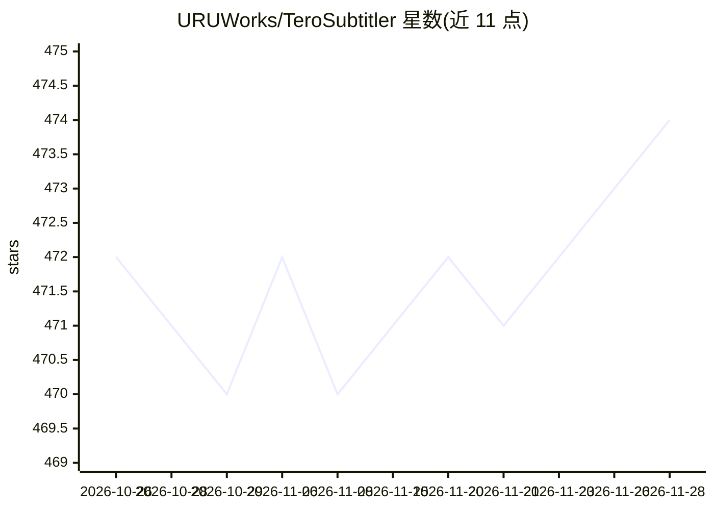

# URUWorks/TeroSubtitler

⭐ 474 · Pascal · MPL-2.0 · 推送 2026-11-27 · [GitHub](https://github.com/URUWorks/TeroSubtitler) · [官网](https://uruworks.net) · 组织维护

**跨平台免费字幕编辑软件，含自动转录与翻译**

面向 Windows、macOS 与 Linux 的开源字幕编辑软件：支持 45+ 字幕格式、SMPTE 与 Media 模式编辑、翻译记忆与术语库、波形时间线与内置镜头变化检测、蓝光 SUP 导入导出、文本转语音与视频配音、批量转换等。AI 相关能力以外部引擎集成形式提供：whisper.cpp / Faster-Whisper 用于音频自动转录为字幕，Google Translate 用于自动翻译，ElevenLabs TTS 用于配音。提供 Windows 安装包与便携版、macOS 与 Linux 下载；源码需 Lazarus 5.0 与 FPC 3.2.4 编译。

## 筛选速览

| 维度 | 判定 | 备注 |
|---|---|---|
| AI 角色 | `ai-enhanced` | 去掉 AI 部分产品仍成立 |
| 许可风险 | `permissive` | MPL-2.0 |
| 部署形态 | `desktop` | 安装包/桌面程序 |
| 模型依赖 | — | README 未给出锁定关系 |
| 硬件要求 | — | 无带数字的原话,不猜 |
| 安装摩擦 | `medium` | 含编译或系统依赖之一 |
| 成熟度 | — | 结构信号不足 |

## 能力要点

- 支持 45+ 字幕格式（SubRip、WebVTT、ASS、TTML、EBU STL 等）
- 集成 whisper.cpp / Faster-Whisper 自动转录音频为字幕
- 时间线波形可视化与内置镜头变化检测
- 翻译记忆、术语库与 Google Translate 自动翻译

## 适用场景

- 为视频制作与本地化团队编辑、校验多格式字幕
- 用自动转录把音频/视频生成字幕初稿再人工修正
- 导入蓝光 SUP 字幕并用 OCR 提取文本

## 场景标签

`语音合成` `语音识别` `OCR` · 领域:内容生成

## 证据(README 行号)

> L12: Tero Subtitler is an open source, cross-platform, and free subtitle editing software for Windows, macOS and Linux.
> L54: ### whisper.cpp / Faster-Whisper
> L56: For the automatic transcription of audio to subtitles.

## 星数曲线

2026-10-26 472 → 2026-11-28 474（+2）

---
*卡片 v1 · prompt 1.4 · 生成 2026-11-28 · 置信度 high · 依据 README sha `2dcd033fe3d5` · [字段定义](../../DATASET.md)*
