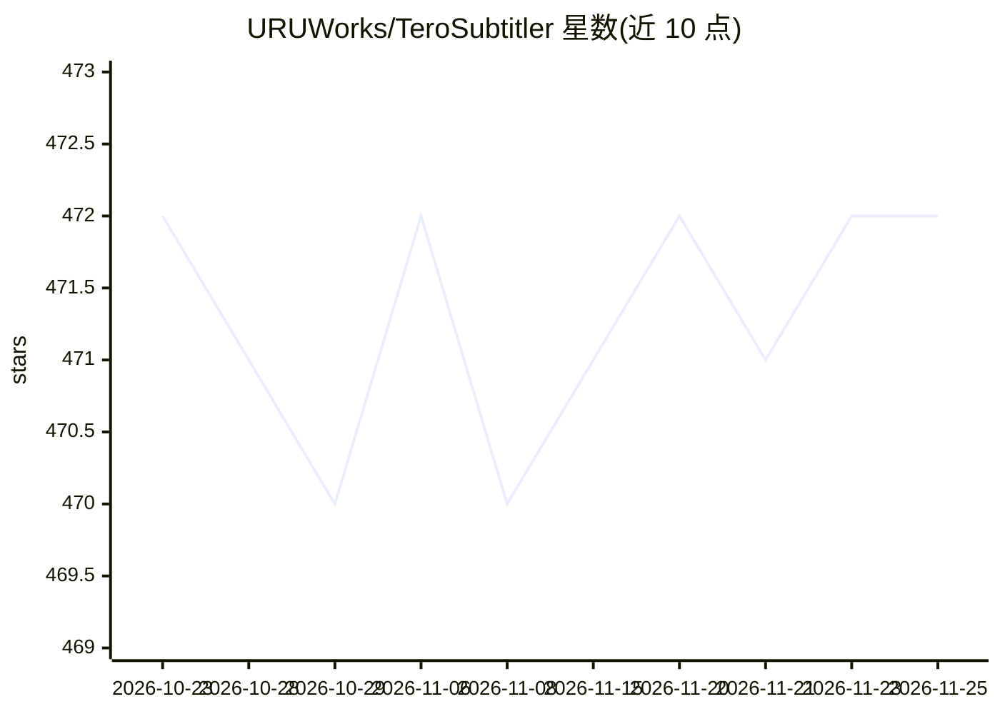

# URUWorks/TeroSubtitler

⭐ 472 · Pascal · MPL-2.0 · 推送 2026-11-23 · [GitHub](https://github.com/URUWorks/TeroSubtitler) · [官网](https://uruworks.net) · 组织维护

**跨平台免费字幕编辑软件：编辑、翻译、转写与配音**

URUWorks 维护的开源字幕编辑软件，覆盖 Windows/macOS/Linux，支持 45+ 字幕格式（SubRip、WebVTT、ASS、EBU STL、Netflix TTML、DCinema 等）。核心功能包括 SMPTE/Media 双模式编辑、翻译记忆与术语库、时间线波形显示与镜头切换检测、自动/手动转写、自动翻译、文本转语音与视频配音、批量转换、Blu-ray SUP 导入导出。播放依赖 mpv 引擎，音视频处理依赖 FFmpeg。需通过 Lazarus IDE 从源码编译。前身项目 Subtitle Workshop 已停止维护并由其接替。

## 筛选速览

| 维度 | 判定 | 备注 |
|---|---|---|
| AI 角色 | `ai-enhanced` | 去掉 AI 部分产品仍成立 |
| 许可风险 | `permissive` | MPL-2.0 |
| 部署形态 | `None` |  |
| 模型依赖 | — | README 未给出锁定关系 |
| 硬件要求 | — | 无带数字的原话,不猜 |
| 安装摩擦 | `medium` | 含编译或系统依赖之一 |
| 成熟度 | — | 结构信号不足 |

## 能力要点

- 支持 45+ 字幕格式读写与批量转换
- 内置 whisper.cpp/Faster-Whisper 音频转写为字幕
- 时间线波形显示与内置镜头切换检测（帧级精确切割）
- 翻译记忆、术语库与自动翻译工作流

## 适用场景

- 为影视内容制作和校验符合行业规范的字幕
- 将音视频自动转写为字幕再人工精修
- 字幕的多语言翻译与视频配音

## 场景标签

`语音识别` `语音合成` · 领域:内容生成

## 证据(README 行号)

> L12: Tero Subtitler is an open source, cross-platform, and free subtitle editing software for Windows, macOS and Linux.
> L54: ### whisper.cpp / Faster-Whisper
> L27: - Source, Translator and Transcription modes

## 星数曲线

2026-10-23 472 → 2026-11-25 472（+0）

---
*卡片 v1 · prompt 1.4 · 生成 2026-11-25 · 置信度 high · 依据 README sha `915fc2e44d34` · [字段定义](../../DATASET.md)*
