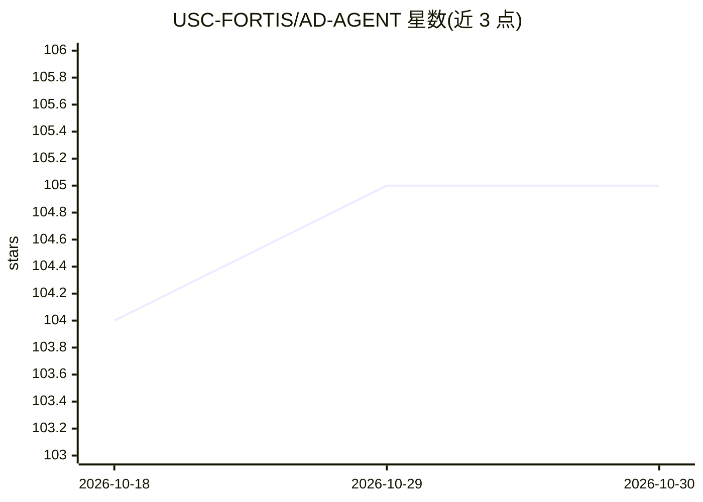

# USC-FORTIS/AD-AGENT

⭐ 105 · Python · BSD-2-Clause · 推送 2026-04-24 · [GitHub](https://github.com/USC-FORTIS/AD-AGENT) · [官网](https://usc-fortis.github.io/AD-AGENT/) · 组织维护

**LLM 多智能体框架：自然语言驱动端到端异常检测**

面向异常检测任务的 LLM 多智能体框架：用户以自然语言描述检测需求（如"在 cardio.mat 上运行 IForest"），由多个专职智能体协作完成模型选择、文档检索、代码生成、代码评审与评估，生成脚本在隔离沙箱（默认 Modal 远程，可选 Docker 本地容器）中执行。支持 pyod（表格）、pygod（图）、tsb_ad（时序）三类库，并提供可直接在 Python 中调用的 Pipeline API。当前处于活跃重构期：尚未发布 pip 安装包，公共 API 仍在稳定化。

## 筛选速览

| 维度 | 判定 | 备注 |
|---|---|---|
| AI 角色 | `ai-native` | 本体是模型或模型工具 |
| 许可风险 | `permissive` | BSD-2-Clause |
| 部署形态 | `library` | 以包/库形式分发 |
| 模型依赖 | — | README 未给出锁定关系 |
| 硬件要求 | — | 无带数字的原话,不猜 |
| 安装摩擦 | `low` | 无编译、无系统依赖或容器化 |
| 成熟度 | `idea` | |

## 能力要点

- 自然语言一句话生成可运行的异常检测脚本
- 多智能体分工：模型选择/文档查找/代码生成/评审/评估
- 跨库支持 pyod、pygod、tsb_ad 三种数据模态
- 生成代码在隔离沙箱执行（Modal 默认，Docker 可选）

## 适用场景

- 用一句自然语言在表格/图/时序数据上跑异常检测
- 不指定算法时让选择智能体按数据推荐候选模型
- 通过 Pipeline API 把检测流程嵌入 notebook 或更大工作流

## 场景标签

`多智能体` · 领域:Agent 开发

## 证据(README 行号)

> L3: **AD-AGENT** is an LLM-driven multi-agent framework for end-to-end anomaly detection. Describe the detection task or
> L13: Running anomaly detection across different data modalities usually means switching libraries, re-learning APIs, and

## 星数曲线

2026-10-18 104 → 2026-10-30 105（+1）

---
*卡片 v1 · prompt 1.4 · 生成 2026-10-23 · 置信度 low · 依据 README sha `2381a5bb34b1` · [字段定义](../../DATASET.md)*
