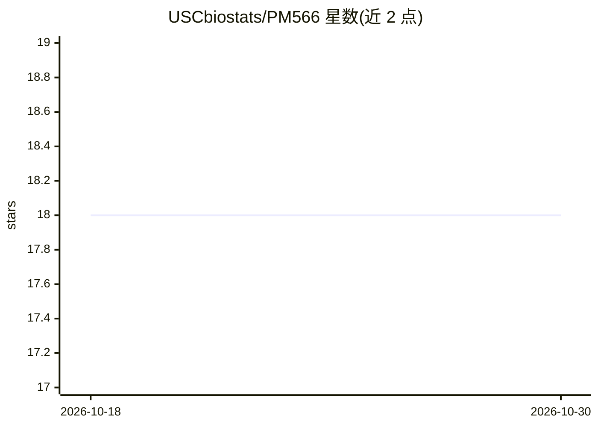

# USCbiostats/PM566

⭐ 18 · R · 推送 2026-08-28 · [GitHub](https://github.com/USCbiostats/PM566) · [官网](https://uscbiostats.github.io/PM566/) · 组织维护

**南加州大学健康数据科学课程（PM566）教学资料仓库**

USC 生物统计系 PM566《健康数据科学导论》的课程材料仓库，供学生获取讲义幻灯片、每周实验、作业，也供教师维护课程网站。仓库按 data/docs/assignments/labs/slides 目录组织，网站通过 Quarto 渲染生成（quarto render），并附有教师每年更新首页、日程与截止日期的清单。课程内容涉及 R 语言、数据可视化、机器学习与网页抓取等主题标签。

## 筛选速览

| 维度 | 判定 | 备注 |
|---|---|---|
| AI 角色 | `ai-knowledge` | 知识聚合/清单类 |
| 许可风险 | `none` | — |
| 部署形态 | `None` |  |
| 模型依赖 | — | README 未给出锁定关系 |
| 硬件要求 | — | 无带数字的原话,不猜 |
| 安装摩擦 | `low` | 无编译、无系统依赖或容器化 |
| 成熟度 | — | 结构信号不足 |

## 能力要点

- 存放课程幻灯片、每周实验与作业等教学材料
- 课程网站由 Quarto 渲染生成（quarto render）
- 提供教师年度更新事项清单

## 适用场景

- 作为学生学习健康数据科学课程的资料来源
- 教师维护与更新课程网站和作业安排

## 场景标签

`教程课程` · 领域:学习与行业

## 证据(README 行号)

> L1: # Course Materials for PM 566
> L14:  - `data` contains datasets used in lecture slides.
> L17:  - `labs` contains weekly labs.

## 星数曲线

2026-10-18 18 → 2026-10-30 18（+0）

---
*卡片 v1 · prompt 1.4 · 生成 2026-10-29 · 置信度 high · 依据 README sha `58dafb9ab6d5` · [字段定义](../../DATASET.md)*
