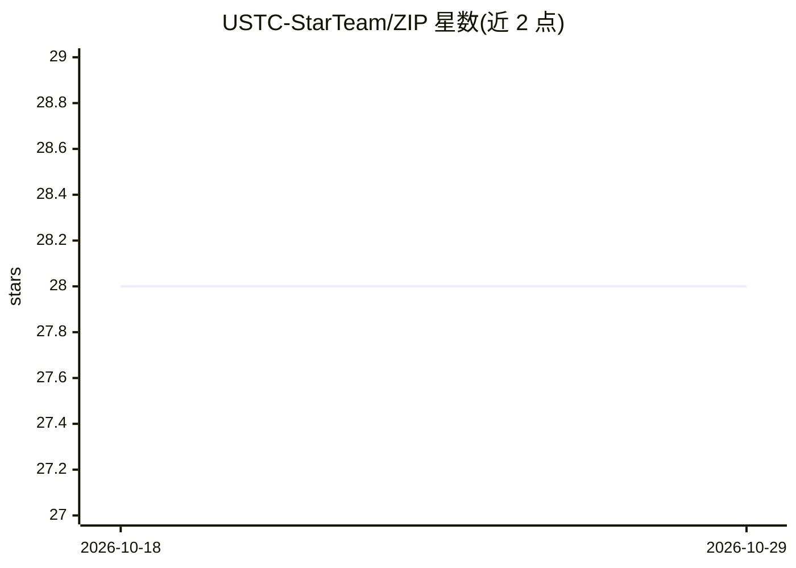

# USTC-StarTeam/ZIP

⭐ 28 · Python · MIT · 推送 2026-06-10 · [GitHub](https://github.com/USTC-StarTeam/ZIP) · [官网](https://ustc-starteam.github.io/ZIP/) · 组织维护 · 中文 README

**基于熵定律的 LLM 指令数据选择方法（arXiv 论文官方实现）**

论文《Entropy Law: The Story Behind Data Compression and LLM Performance》的官方实现。ZIP 以压缩比作为数据选择信号，在给定预算下通过全局候选过滤与局部贪心选择的分阶段流程，从 ShareGPT 式对话池中挑出降低信息冗余、保留多样学习信号的子集。仓库仅含单脚本 ZIP.py 与参数（--budget、--k1/--k2/--k3、--n_jobs），依赖 torch；对齐与评测交由外部工具 Axolotl 和 FastChat（MT-Bench）完成。选择过程为 CPU-only，论文称无需专有 LLM 评分或代理模型。

## 筛选速览

| 维度 | 判定 | 备注 |
|---|---|---|
| AI 角色 | `ai-ecosystem` | LLM/agent 周边工具 |
| 许可风险 | `permissive` | MIT |
| 部署形态 | `library` | 以包/库形式分发 |
| 模型依赖 | — | README 未给出锁定关系 |
| 硬件要求 | — | 无带数字的原话,不猜 |
| 安装摩擦 | `low` | 无编译、无系统依赖或容器化 |
| 成熟度 | — | 结构信号不足 |

## 能力要点

- 以压缩比为信号的分阶段数据选择（全局过滤+局部贪心）
- 接受 ShareGPT 式对话记录，输出 selected_data.json 供下游对齐工具使用
- 论文报告选择过程 CPU-only 约 4.5 小时，无需专有 LLM 评分或代理模型

## 适用场景

- 为 LLM SFT/对齐从大规模指令池中筛选子集
- 按预算控制指令微调数据量并降低信息冗余
- 复现论文中 Mistral-7B/Llama-3-8B 的数据选择实验

## 场景标签

`微调` · 领域:训练与推理

## 证据(README 行号)

> L15: ZIP selects instruction data through an entropy-law view of compression: a useful selected subset should reduce red
> L22: - Keeps alignment and evaluation decoupled: ZIP selects data, while Axolotl and FastChat can handle SFT and MT-Benc

## 星数曲线

2026-10-18 28 → 2026-10-29 28（+0）

---
*卡片 v1 · prompt 1.4 · 生成 2026-10-26 · 置信度 mid · 依据 README sha `8e9b6f4ace9b` · [字段定义](../../DATASET.md)*
