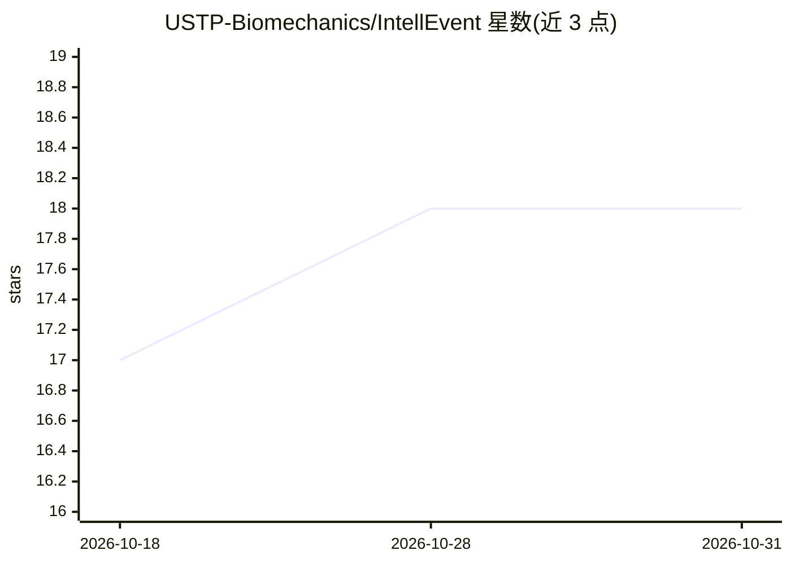

# USTP-Biomechanics/IntellEvent

⭐ 18 · Python · CC-BY-4.0 · 推送 2026-04-10 · [GitHub](https://github.com/USTP-Biomechanics/IntellEvent) · 组织维护

**面向多种病理性步态的深度学习步态事件检测算法（Vicon Nexus 集成）**

基于深度学习的步态事件检测框架：从 3D 动作捕捉数据中自动检测初始触地（IC）与离地（FO）事件，覆盖下肢旋转畸形、马蹄足、脑瘫、下垂足及健康对照等多种人群。模型输入为左右 HEEL/ANKLE/TOE 标记点的三向速度，训练数据含 1211 名患者与 61 名健康对照。以 Vicon Nexus 管线插件形式提供（经 vicon_server.exe 与 Python 操作脚本集成），在 Vicon Nexus 2.14 及以上版本测试，无需安装。各病理类别 MAE 已在 README 中列出。

## 筛选速览

| 维度 | 判定 | 备注 |
|---|---|---|
| AI 角色 | `ai-native` | 本体是模型或模型工具 |
| 许可风险 | `viral` | CC-BY-4.0 |
| 部署形态 | `desktop` | 安装包/桌面程序 |
| 模型依赖 | — | README 未给出锁定关系 |
| 硬件要求 | — | 无带数字的原话,不猜 |
| 安装摩擦 | `low` | 无编译、无系统依赖或容器化 |
| 成熟度 | — | 结构信号不足 |

## 能力要点

- 检测 IC 与 FO 两类步态事件，覆盖多种病理性步态
- 训练数据含 1211 名患者、61 名健康对照（5 个类别）
- 以 Vicon Nexus 管线插件形式交付，声明无需安装
- 提供各病理类别的 MAE 结果表与论文出处

## 适用场景

- 在 Vicon Nexus 步态分析流程中自动标注 IC/FO 事件
- 临床 3D 步态分析中处理脑瘫、马蹄足等病理数据的事件检测
- 科研中复现论文中的步态事件检测方法

## 场景标签

 · 领域:临床步态分析/生物力学

## 证据(README 行号)

> L4: *IntellEvent* is a robust deep learning-based framework for gait event detection across various pathologies for 3D m
> L28: **This framework has been tested with Vicon Nexus version 2.14 and higher. No installation required!**

## 星数曲线

2026-10-18 17 → 2026-10-31 18（+1）

---
*卡片 v1 · prompt 1.4 · 生成 2026-10-29 · 置信度 high · 依据 README sha `e6e8fd70da3a` · [字段定义](../../DATASET.md)*
