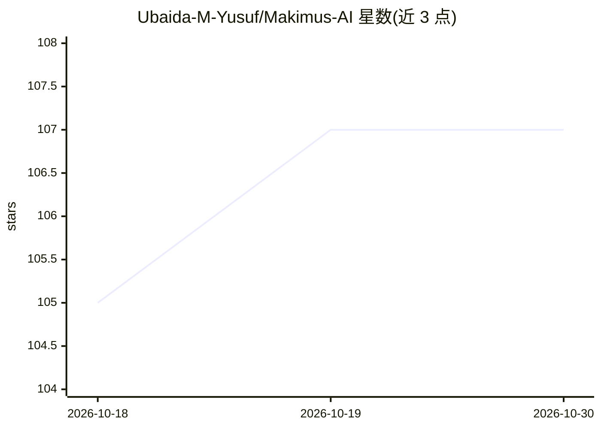

# Ubaida-M-Yusuf/Makimus-AI

⭐ 107 · Python · NOASSERTION · 推送 2026-07-07 · [GitHub](https://github.com/Ubaida-M-Yusuf/Makimus-AI) · 个人维护

**本地 AI 媒体搜索：用文字或图片搜图库与视频库**

面向个人用户的本地媒体语义搜索应用：基于 CLIP（ViT-L-14，open_clip_torch）索引本地图片、RAW 照片与视频，支持文搜图、图搜图、文搜视频、图搜视频，带负向词、拖拽图搜索、相似度阈值与 Best Frame 模式。模型约 1.7GB 首次运行自动下载并缓存本地，全程离线推理。提供 Tkinter GUI 与增量缓存，支持 NVIDIA CUDA/Apple MPS/DirectML 及 CPU 回退；GitHub 免费源码需自行 Python 环境安装，另在 Patreon/Fansky 提供打包 Windows 安装器。许可为 CC BY-NC-SA 4.0（非商用）。

## 筛选速览

| 维度 | 判定 | 备注 |
|---|---|---|
| AI 角色 | `ai-native` | 本体是模型或模型工具 |
| 许可风险 | `none` | NOASSERTION |
| 部署形态 | `library` | 以包/库形式分发 |
| 模型依赖 | — | README 未给出锁定关系 |
| 硬件要求 | `cpu-ok` | |
| 安装摩擦 | `medium` | 含编译或系统依赖之一 |
| 成熟度 | — | 结构信号不足 |

## 能力要点

- 文搜图/图搜图/文搜视频/图搜视频四种检索模式
- RAW 照片（ARW/CR2/NEF/DNG 等）与多格式视频索引
- 首次运行自动下载 ViT-L-14（约1.7GB）并缓存，完全本地推理
- 增量缓存与边索引边搜索

## 适用场景

- 用自然语言描述在本地照片库中找图
- 用一张参考图找视觉相似的照片或视频帧
- 整理 RAW 拍摄素材与视频片段，导出/移动/删除检索结果

## 场景标签

`语义搜索` · 领域:知识与检索

## 证据(README 行号)

> L5: Search your entire image and video library using **natural language or an image** — type what you're looking for or 
> L7: > Type *"girl in red armor"* or *"dog playing in snow"* — or click **Image** to search by visual similarity. Support
> L200: 1. Launch the app — on **first run it will automatically download the AI model (~1.7 GB)** from HuggingFace. This 

## 星数曲线

2026-10-18 105 → 2026-10-30 107（+2）

---
*卡片 v1 · prompt 1.4 · 生成 2026-10-23 · 置信度 high · 依据 README sha `8a5fa7cec9a2` · [字段定义](../../DATASET.md)*
