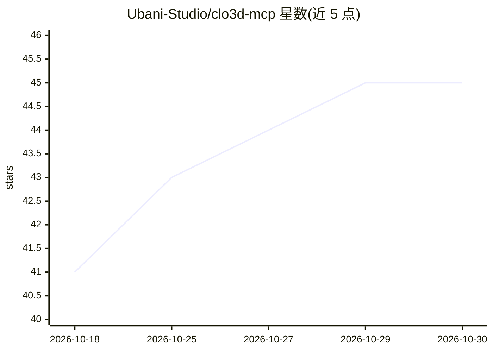

# Ubani-Studio/clo3d-mcp

⭐ 45 · Python · MIT · 推送 2026-10-18 · [GitHub](https://github.com/Ubani-Studio/clo3d-mcp) · 组织维护

**让 Claude/Cursor 等 MCP 客户端控制 CLO3D 服装设计的 MCP 服务器**

由 CLO3D 内运行的插件和独立 MCP server 两部分组成，通过共享临时目录的文件式 IPC 通信，插件调用 CLO3D Python API。提供 46 个工具，覆盖项目管理、版片操作、面料与配色、布料模拟、OBJ/FBX/GLB 导出、技术包生成等，支持加载自定义工具扩展。要求 CLO3D 具备 Python 脚本支持、Python 3.10+，插件每次会话需手动运行；模拟/导出默认超时 180 秒。

## 筛选速览

| 维度 | 判定 | 备注 |
|---|---|---|
| AI 角色 | `ai-ecosystem` | LLM/agent 周边工具 |
| 许可风险 | `permissive` | MIT |
| 部署形态 | `None` |  |
| 模型依赖 | — | README 未给出锁定关系 |
| 硬件要求 | — | 无带数字的原话,不猜 |
| 安装摩擦 | `low` | 无编译、无系统依赖或容器化 |
| 成熟度 | — | 结构信号不足 |

## 能力要点

- 46 个工具覆盖版片、面料、模拟、导出与技术包
- 单文件插件无外部依赖，基于临时目录文件 IPC
- 支持加载私有自定义工具且不能覆盖内置工具

## 适用场景

- 在对话窗口里脚本化 CLO3D 的重复性任务
- 用自然语言换面料、跑模拟、批量导出模型
- 把自有版块命名规则做成私有工具随服务器加载

## 场景标签

`工作流自动化` · 领域:效率与自动化

## 证据(README 行号)

> L3: Talk to CLO3D from Claude, Cursor, or any MCP client. Create patterns, swap fabrics, run simulations, export models.
> L118: **The MCP server** (`src/clo3d_mcp/`) is a Python package that writes commands to that directory and reads respons
> L121: ┌─────────────────┐   file-based IPC  ┌──────────────────┐     CLO3D API     ┌────────┐

## 星数曲线

2026-10-18 41 → 2026-10-30 45（+4）

---
*卡片 v1 · prompt 1.4 · 生成 2026-10-25 · 置信度 high · 依据 README sha `63161da419f9` · [字段定义](../../DATASET.md)*
