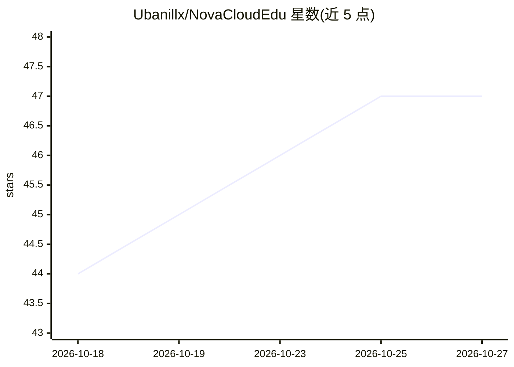

# Ubanillx/NovaCloudEdu

⭐ 47 · Dart · NOASSERTION · 推送 2026-04-27 · [GitHub](https://github.com/Ubanillx/NovaCloudEdu) · [官网](https://novacloudedu.ubanillx.com/) · 个人维护 · 中文 README

**面向教育的 AI+ SaaS 平台：课程/知识库/AI 助手多端一体化**

智云星课是基于 Spring Boot + React + Flutter 的多端（Web/Android/iOS）智慧教育 SaaS 平台。教育功能含课程/班级/教师管理、HLS 视频播放、WebSocket 社交、PDF/EPUB 电子书阅读与会员体系；AI 部分通过 Langchain4j 多模型路由（通义/GPT/DeepSeek/Moonshot/智谱/SiliconFlow/Ollama）提供 SSE 流式对话、RAG 知识库、OCR 批改、AI 出卷与 PPT 生成、可视化 DAG 工作流与 MCP 集成。后端采用 DDD 四层架构，需 PostgreSQL/Redis 等外部服务，提供 Docker 一键启动与本地开发两种部署方式。许可证为 CC BY-NC-SA 4.0（非商业）。

## 筛选速览

| 维度 | 判定 | 备注 |
|---|---|---|
| AI 角色 | `ai-enhanced` | 去掉 AI 部分产品仍成立 |
| 许可风险 | `none` | NOASSERTION |
| 部署形态 | `None` |  |
| 模型依赖 | local-ok | 支持本地模型 |
| 硬件要求 | — | 无带数字的原话,不猜 |
| 安装摩擦 | `low` | 无编译、无系统依赖或容器化 |
| 成熟度 | — | 结构信号不足 |

## 能力要点

- Langchain4j 多模型路由（通义/GPT/DeepSeek/Moonshot/智谱/SiliconFlow/Ollama）
- RAG 知识库：文档解析→向量 Embedding→Rerank 检索增强
- OCR 识别 + AI 批改 + 知识画像 + 错题推荐
- 可视化 DAG 工作流引擎（18 种节点执行器）与 MCP 服务器集成

## 适用场景

- 搭建带 AI 助手的在线课程与班级管理平台
- 为学生提供电子书 AI 摘要问答与智能批改
- 通过 AI 配额的会员体系运营教育服务

## 场景标签

`工作流自动化` `AI 助手` `RAG` `OCR` · 领域:效率与自动化

## 证据(README 行号)

> L5:  **AI 驱动的智慧教育云平台**
> L85: ## 核心功能
> L89: |**AI 智能助手**|多模型路由、SSE 流式对话、MCP 服务器集成|

## 星数曲线

2026-10-18 44 → 2026-10-27 47（+3）

---
*卡片 v1 · prompt 1.4 · 生成 2026-10-25 · 置信度 high · 依据 README sha `714400cacaf8` · [字段定义](../../DATASET.md)*
