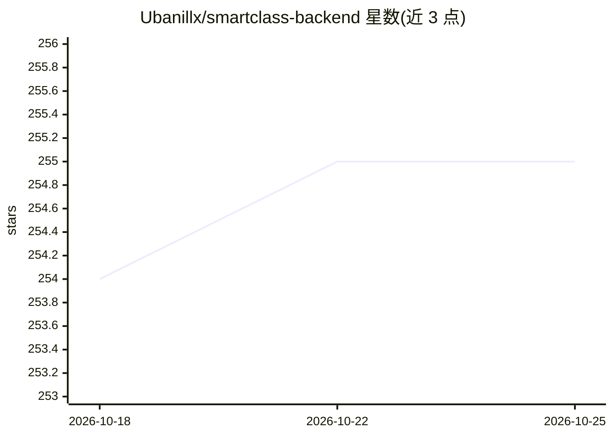

# Ubanillx/smartclass-backend

⭐ 255 · Java · AGPL-3.0 · 推送 2026-02-06 · [GitHub](https://github.com/Ubanillx/smartclass-backend) · 个人维护 · 中文 README

**基于Spring Boot与Dify的学习平台后端，含AI对话与教学管理**

智云星课是一个Spring Boot 2.7.2后端系统，面向在线学习场景，提供课程管理、学习进度跟踪、每日文章与单词学习、用户成长体系等教学管理功能。AI能力通过集成Dify API实现：支持多智能体配置、流式/阻塞式聊天、文本与图片多模态输入、AI分身管理。技术栈含MyBatis Plus、Redis、MySQL、Elasticsearch，提供Docker Compose部署与Knife4j接口文档。README声明本项目不再更新，新版移至NovaCloudEdu仓库。AGPL-3.0许可且禁止商业使用。

## 筛选速览

| 维度 | 判定 | 备注 |
|---|---|---|
| AI 角色 | `ai-native` | 本体是模型或模型工具 |
| 许可风险 | `viral` | AGPL-3.0 |
| 部署形态 | `self-host` | docker 或自建部署 |
| 模型依赖 | — | README 未给出锁定关系 |
| 硬件要求 | — | 无带数字的原话,不猜 |
| 安装摩擦 | `low` | 无编译、无系统依赖或容器化 |
| 成熟度 | — | 结构信号不足 |

## 能力要点

- 集成Dify API，支持多智能体配置与流式响应
- 课程/章节/小节管理与学习数据统计分析
- 每日文章推送、单词学习与个性化推荐
- SSE实时消息推送与Postman接口调试支持

## 适用场景

- 搭建带AI助手的教学管理平台后端
- 为移动端学习应用提供课程、打卡与对话API
- 接入Dify智能体提供多角色AI学习助手

## 场景标签

`聊天机器人` · 领域:对话与助手

## 证据(README 行号)

> L7: 智云星课是一个基于Spring Boot和AI技术的智能学习平台系统，提供了丰富的教学管理功能和AI互动特性，为用户打造全方位、智能化的学习体验。项目集成了Dify AI接口，支持AI聊天、课程学习、资料分享、打卡记录、单词记忆、课
> L35: * 基于Dify API的智能聊天系统
> L161: ## Dify API集成

## 星数曲线

2026-10-18 254 → 2026-10-25 255（+1）

---
*卡片 v1 · prompt 1.4 · 生成 2026-10-22 · 置信度 high · 依据 README sha `8efb1a9e8f25` · [字段定义](../../DATASET.md)*
