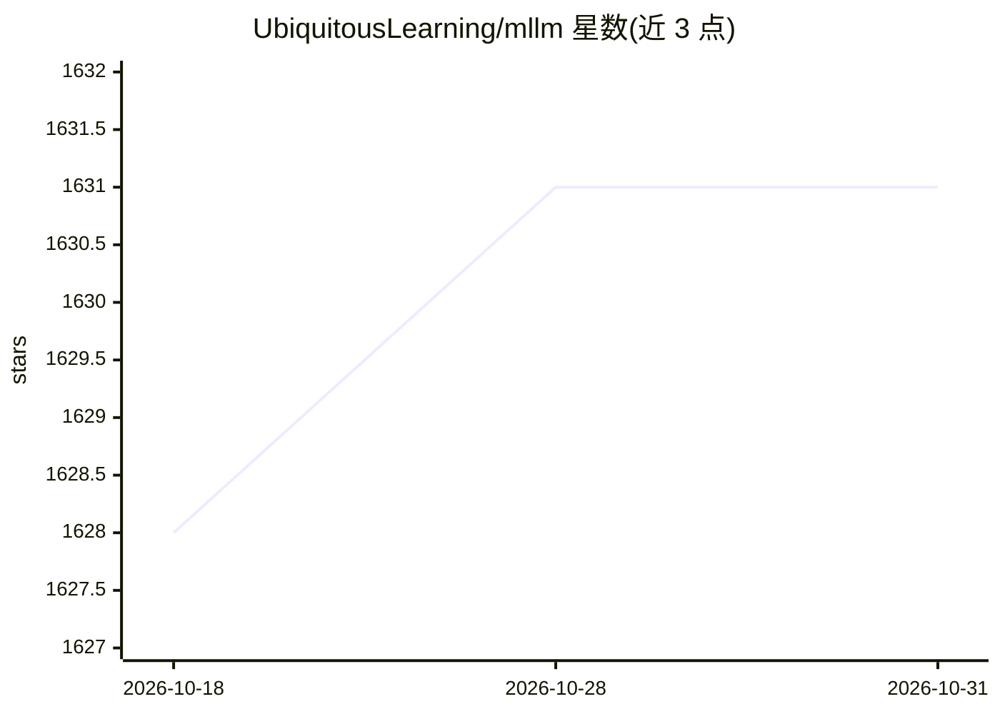

# UbiquitousLearning/mllm

⭐ 1,631 · C++ · MIT · 推送 2026-09-30 · [GitHub](https://github.com/UbiquitousLearning/mllm) · [官网](https://ubiquitouslearning.github.io/mllm/) · 组织维护

**面向移动/边缘设备的多模态 LLM 推理引擎**

C++ 实现的多模态大模型推理引擎，面向手机、Jetson、Ascend NPU 等移动与边缘设备，支持 Arm CPU、OpenCL GPU、QNN/Ascend NPU 等后端。提供 Pythonic eager execution 的模型编写 API、计算图 trace、量化/剪枝/投机执行等优化，以及 mllm-convertor 将 PyTorch/SafeTensors 检查点转换后由运行时执行。支持 Qwen3、MiniCPM5、DeepSeek-OCR、Qwen2-VL 等数十种模型。通过源码编译或 Docker 构建，pymllm 提供 CUDA/Jetson 量化 serving 路径。

## 筛选速览

| 维度 | 判定 | 备注 |
|---|---|---|
| AI 角色 | `ai-ecosystem` | LLM/agent 周边工具 |
| 许可风险 | `permissive` | MIT |
| 部署形态 | `self-host` | docker 或自建部署 |
| 模型依赖 | — | README 未给出锁定关系 |
| 硬件要求 | — | 无带数字的原话,不猜 |
| 安装摩擦 | `low` | 无编译、无系统依赖或容器化 |
| 成熟度 | `idea` | |

## 能力要点

- 统一硬件后端：Arm CPU / OpenCL GPU / QNN NPU / Ascend NPU
- Pythonic eager execution 模型编写与 trace 计算图提取
- 量化（W4A16/W8A8/INT4）、剪枝、投机执行等优化
- mllm-convertor 直接读取 PyTorch/SafeTensors 检查点并转换

## 适用场景

- 在 Android 手机上本地运行 Qwen3、DeepSeek-OCR 等模型
- 在 Jetson Orin 上以 W4A16/W8A8 量化部署 Qwen3-VL serving
- 将多模态模型部署到 Hexagon/Ascend NPU 边缘设备

## 场景标签

`推理引擎` `多模态` · 领域:感知与多模态

## 证据(README 行号)

> L3: **Fast and lightweight multimodal LLM inference engine for mobile and edge devices**
> L58: 2. **Unified hardware support** – Arm CPU, OpenCL GPU, QNN NPU, Ascend NPU
> L67: The mllm framework integrates seamlessly with popular community frameworks' checkpoints. Through mllm-convertor, it

## 星数曲线

2026-10-18 1,628 → 2026-10-31 1,631（+3）

---
*卡片 v1 · prompt 1.4 · 生成 2026-10-21 · 置信度 high · 依据 README sha `7fab379d75f9` · [字段定义](../../DATASET.md)*
