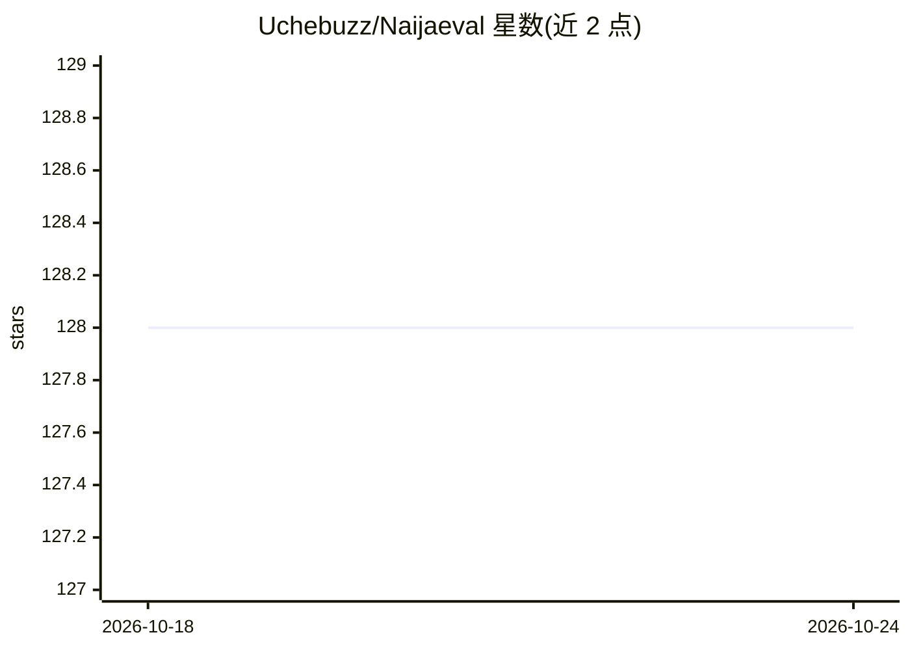

# Uchebuzz/Naijaeval

⭐ 128 · Python · NOASSERTION · 推送 2026-06-22 · [GitHub](https://github.com/Uchebuzz/Naijaeval) · 个人维护

**面向非洲语言的 AI 系统评测指标工具包**

Python 评测工具包，针对主流基准未覆盖的非洲语言场景（约鲁巴、伊博、豪萨、尼日利亚皮钦、斯瓦希里语等）提供可组合的任务无关指标：语码转换率、方言鲁棒性、术语保留率、幻觉率、WER/CER 等，内置医疗/法律/金融/客服领域术语表与 7 种语言词表。支持 CLI 与 Python API，内置 naija_mt_v1（英→约鲁巴翻译，MENYO-20k）与 coswitch_asr_v1（Common Voice）两个基准任务，可注册自定义指标与数据集。Apache 2.0 许可。

## 筛选速览

| 维度 | 判定 | 备注 |
|---|---|---|
| AI 角色 | `ai-ecosystem` | LLM/agent 周边工具 |
| 许可风险 | `none` | NOASSERTION |
| 部署形态 | `library` | 以包/库形式分发 |
| 模型依赖 | — | README 未给出锁定关系 |
| 硬件要求 | — | 无带数字的原话,不猜 |
| 安装摩擦 | `low` | 无编译、无系统依赖或容器化 |
| 成熟度 | — | 结构信号不足 |

## 能力要点

- 9 类指标覆盖鲁棒性/保真/ASR/一致性（含幻觉检测）
- 7 种非洲语言内置词表与 4 个领域术语表
- 可注册自定义指标与数据集的扩展机制
- 提供 CLI 与 Python API 两种使用方式

## 适用场景

- 评测面向尼日利亚英语或非洲低资源语言的模型表现
- 测量模型在语码转换与方言输入下的性能退化
- 检查翻译输出中医疗/法律术语的保留情况

## 场景标签

`模型评测` · 领域:评测与运维

## 证据(README 行号)

> L3: **Evaluation infrastructure for AI systems that mainstream benchmarks can't assess — built for African languages, co
> L22: NaijaEval provides composable, task-agnostic metrics that work on real African language evaluation challenges — out
> L46: |Metric|Category|Description|

## 星数曲线

2026-10-18 128 → 2026-10-24 128（+0）

---
*卡片 v1 · prompt 1.4 · 生成 2026-10-23 · 置信度 high · 依据 README sha `f98e83b4c6f3` · [字段定义](../../DATASET.md)*
