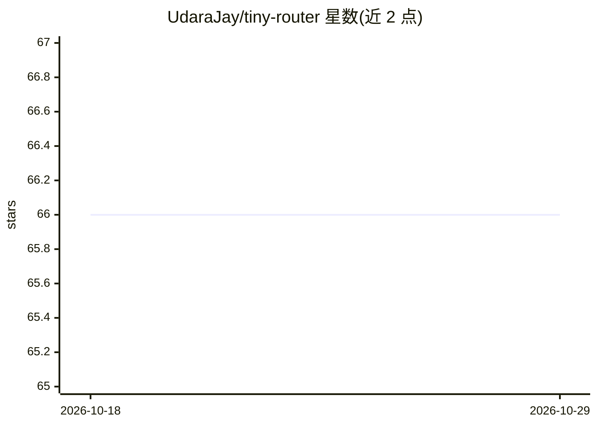

# UdaraJay/tiny-router

⭐ 66 · Python · MIT · 推送 2026-03-23 · [GitHub](https://github.com/UdaraJay/tiny-router) · [官网](https://huggingface.co/tgupj/tiny-router) · 个人维护

**开发者用的多_HEAD文本路由分类器，预测四类信号供下游自动化**

面向开发者的实验性多头文本分类器，用于短文本的领域中立路由决策：从当前文本与可选交互上下文预测 relation_to_previous、actionability、retention、urgency 四个标签头，供 agent 或产品流程的自动化使用。默认编码器为 deberta-v3-small，可用标志切换 MiniLM、distilbert、bert-tiny 等替代；采用依赖感知的多头结构与逐头温度校准。提供训练、评测（含消融与 ECE）、ONNX 导出与推理 CLI，通过 uv/make 从源码运行，README 注明启用自动路由前需在类生产数据上校准置信阈值。

## 筛选速览

| 维度 | 判定 | 备注 |
|---|---|---|
| AI 角色 | `ai-native` | 本体是模型或模型工具 |
| 许可风险 | `permissive` | MIT |
| 部署形态 | `None` |  |
| 模型依赖 | — | README 未给出锁定关系 |
| 硬件要求 | — | 无带数字的原话,不猜 |
| 安装摩擦 | `low` | 无编译、无系统依赖或容器化 |
| 成熟度 | `idea` | |

## 能力要点

- 四标签头预测：与上一消息关系、可操作性、保留策略、紧急度
- 默认 deberta-v3-small 编码器，可切换 MiniLM/distilbert/bert-tiny 或兼容编码器
- 逐头温度校准与置信阈值下的 automation-safe 准确率评测
- 支持 ONNX 导出与 int8 量化推理

## 适用场景

- 在 agent 工作流中作为第一道路由闸门决定自动执行/人工审核/忽略
- 根据消息的保留价值制定记忆与上下文管理策略
- 按紧急度信号做队列排序与通知策略

## 场景标签

 · 领域:NLP/机器学习

## 证据(README 行号)

> L3: `tiny-router` is a compact experimental multi-head text classifier for short, domain-neutral routing decisions. It p
> L23: The model emits four separate signals that are meant to be useful to downstream automation systems:

## 星数曲线

2026-10-18 66 → 2026-10-29 66（+0）

---
*卡片 v1 · prompt 1.4 · 生成 2026-10-24 · 置信度 high · 依据 README sha `86067e8ae499` · [字段定义](../../DATASET.md)*
