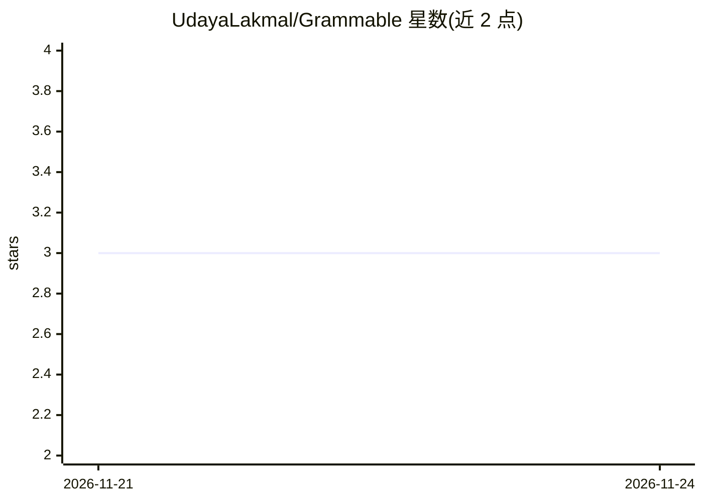

# UdayaLakmal/Grammable

⭐ 3 · Swift · GPL-3.0 · 推送 2026-11-19 · [GitHub](https://github.com/UdayaLakmal/Grammable) · [官网](https://github.com/UdayaLakmal/Grammable) · 个人维护

**macOS 全局 AI 写作助手：用已有 AI 工具改写任意应用中的文本**

一个 Swift 编写的 macOS 菜单栏应用，将用户已安装的 AI 命令行工具（Claude Code、Codex CLI、Gemini CLI、Antigravity、Devin）或本地运行时（Ollama、LM Studio、Apple Intelligence）接入系统级写作流程：选中任意应用中的文本即可修复语法、调整语气、改写和格式化，通过 ⌃⌥G 快捷键或弹出的 G 按钮触发，逐条接受/拒绝修改，结果标注 On-device 或 Cloud 来源。本身不捆绑模型、不调用自有服务器，语法修复在无 AI 时回退到 macOS 内置检查器。需授予辅助功能权限；安装方式为 Homebrew、Release 下载或源码构建（Xcode 15+）。GPL v3，无订阅无账户。

## 筛选速览

| 维度 | 判定 | 备注 |
|---|---|---|
| AI 角色 | `ai-enhanced` | 去掉 AI 部分产品仍成立 |
| 许可风险 | `viral` | GPL-3.0 |
| 部署形态 | `desktop` | 安装包/桌面程序 |
| 模型依赖 | local-ok | 支持本地模型 |
| 硬件要求 | — | 无带数字的原话,不猜 |
| 安装摩擦 | `low` | 无编译、无系统依赖或容器化 |
| 成熟度 | — | 结构信号不足 |

## 能力要点

- 驱动用户已安装的 CLI 工具与本地模型，无需 API key 或新订阅
- 语法修复无 AI 时回退到 macOS 内置拼写/语法检查器
- 自定义预设为 Markdown 文件，可分享复用
- 每条结果显示 On-device/Cloud 隐私徽章，支持按应用排除

## 适用场景

- 在 Mail/Slack/Word 等任意应用里选中文字一键修复语法
- 把草稿改写成 Professional 语气或邮件格式后一键粘贴回去
- 用本地 Ollama 离线处理文本，数据不出本机

## 场景标签

`AI 写作` · 领域:内容生成

## 证据(README 行号)

> L51: It's a tiny **menu bar app** that turns the AI tools already installed on your Mac into a **system-wide writing ass
> L119: Grammable never bundles a model or calls its own server. It drives tools **you already have installed** — and work
> L94: - 🪶 **Native & lightweight** — Swift + SwiftUI, ~2 MB universal binary (Apple silicon & Intel), no Electron. Runs o

## 星数曲线

2026-11-21 3 → 2026-11-24 3（+0）

---
*卡片 v1 · prompt 1.4 · 生成 2026-11-22 · 置信度 mid · 依据 README sha `1c1b5b167224` · [字段定义](../../DATASET.md)*
