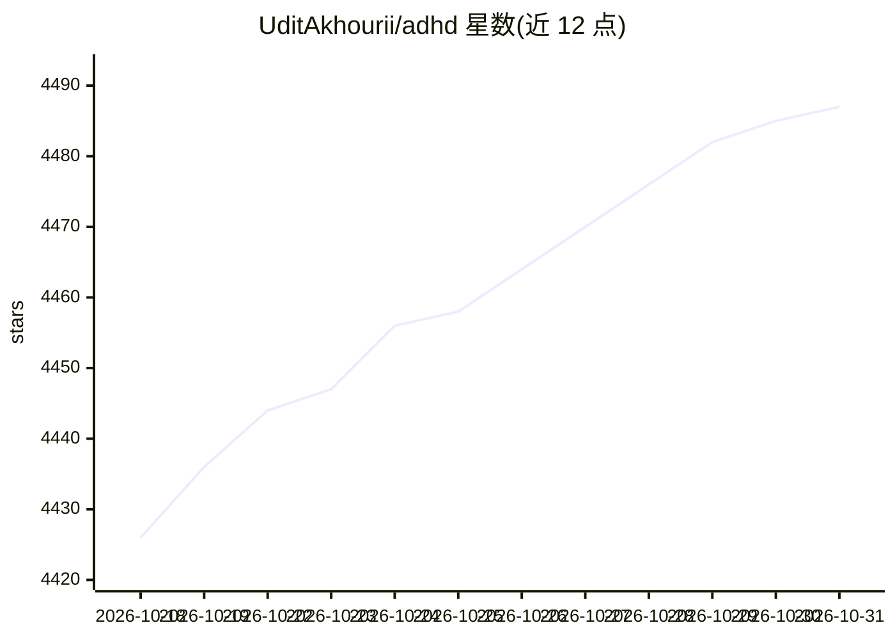

# UditAkhourii/adhd

⭐ 4,487 · TypeScript · MIT · 推送 2026-10-25 · [GitHub](https://github.com/UditAkhourii/adhd) · [官网](https://divergent.sh) · 个人维护

**给编码 agent 的发散思维技能：并行多框架生成、评分并剪枝想法**

面向编码代理（Claude Code、Codex 等）的技能与 npm 包：对设计决策、模糊调试、命名、策略等开放性问题，先在 N 个相互隔离的认知框架下并行发起多个发散推理调用（分支间零共享上下文），再由独立的批评调用按新颖性/可行性/契合度打分、标记陷阱、聚类，并对幸存想法深化为带风险与首步的草图。提供 CLI、TypeScript 库与 SKILL.md 技能形式，一条 npx 命令可自动检测约 50 种 agent 安装。评测基于 6 个开放工程问题、由独立 LLM 评判；外部基准显示时间成本约 2.3 倍。

## 筛选速览

| 维度 | 判定 | 备注 |
|---|---|---|
| AI 角色 | `ai-native` | 本体是模型或模型工具 |
| 许可风险 | `permissive` | MIT |
| 部署形态 | `library` | 以包/库形式分发 |
| 模型依赖 | — | README 未给出锁定关系 |
| 硬件要求 | — | 无带数字的原话,不猜 |
| 安装摩擦 | `low` | 无编译、无系统依赖或容器化 |
| 成熟度 | `idea` | |

## 能力要点

- 两阶段循环：N 个隔离框架并行发散 + 独立批评调用评分/剪枝
- 生成器-批评家拆分为独立的 LLM 调用，而非单提示内承诺
- 支持 15 种认知框架，可自定义
- 提供 CLI、TypeScript 库与 SKILL.md 技能三种形态

## 适用场景

- 让编码 agent 在设计决策或 API 设计时产出多个差异化方案
- 模糊调试时发散探索非显然的解决路径
- 命名、策略类开放问题需要多角度候选想法

## 场景标签

`Agent 框架` `提示工程` · 领域:Agent 开发

## 证据(README 行号)

> L22: Linear Chain-of-Thought anchors on whatever it says first. Tree-of-Thought widens the search but still walks a sing
> L111: 1. **Diverge.** Pick N cognitive frames. Spawn N parallel, **isolated** Agent calls — each sees the problem plus o
> L112: 2. **Focus.** A separate critic call scores every idea (`novelty / viability / fit`), flags traps with reasons, cl

## 星数曲线

2026-10-18 4,426 → 2026-10-31 4,487（+61）

---
*卡片 v1 · prompt 1.4 · 生成 2026-10-20 · 置信度 high · 依据 README sha `f1763f5b8776` · [字段定义](../../DATASET.md)*
