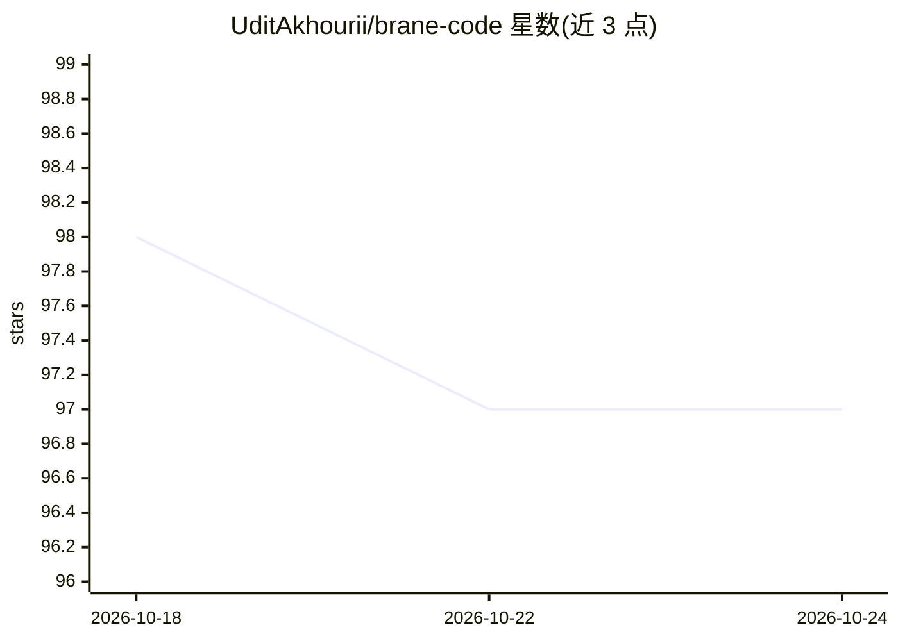

# UditAkhourii/brane-code

⭐ 97 · TypeScript · 推送 2026-03-31 · [GitHub](https://github.com/UditAkhourii/brane-code) · [官网](https://gobrane.com) · 个人维护

**终端里的模型无关 AI 编码运行时，执行多步编码任务**

CLI 形态的 AI 编码运行时：接受自然语言指令，规划并执行多步编码任务，可读写编辑文件、运行命令与工具，输出 diff 与说明。模型无关，当前支持 OpenAI 与 OpenRouter，可扩展其他提供商；本地运行。作者声明其为 Claude Code 风格运行时的独立替代实现，与 Anthropic 无关联。README 标注当前为早期版本，规划中的方向包括跨会话持久记忆、可回放工作流与可检视的 agent 运行记录。

## 筛选速览

| 维度 | 判定 | 备注 |
|---|---|---|
| AI 角色 | `ai-native` | 本体是模型或模型工具 |
| 许可风险 | `none` | — |
| 部署形态 | `None` |  |
| 模型依赖 | locked-api |  |
| 硬件要求 | — | 无带数字的原话,不猜 |
| 安装摩擦 | `low` | 无编译、无系统依赖或容器化 |
| 成熟度 | `idea` | |

## 能力要点

- 自然语言指令驱动的多步编码任务规划与执行
- 模型无关：支持 OpenAI 与 OpenRouter，可扩展
- 本地运行，可读写文件、运行命令与调用工具
- 输出 diff 与解释

## 适用场景

- 在终端用自然语言让 AI 修复代码 bug
- 在本地用不同 LLM 提供商执行编码任务
- 替代 Claude Code 风格的命令行编码工具

## 场景标签

`编码 Agent` · 领域:编码与开发

## 证据(README 行号)

> L8: Brane Code is a simple CLI-based AI coding runtime that:
> L31: * Accepts natural language instructions
> L32: * Plans and executes coding tasks

## 星数曲线

2026-10-18 98 → 2026-10-24 97（-1）

---
*卡片 v1 · prompt 1.4 · 生成 2026-10-23 · 置信度 high · 依据 README sha `1f827c2b2055` · [字段定义](../../DATASET.md)*
