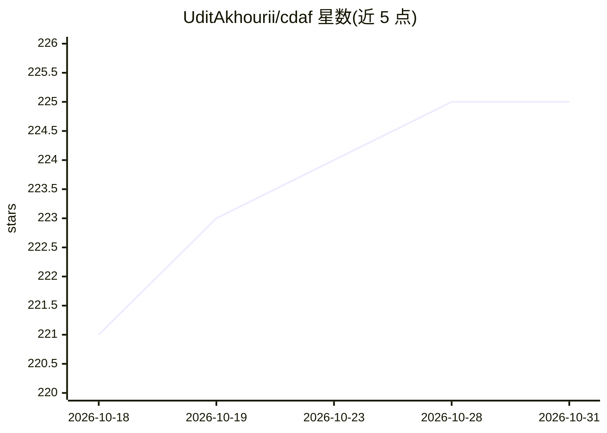

# UditAkhourii/cdaf

⭐ 225 · Python · MIT · 推送 2026-08-28 · [GitHub](https://github.com/UditAkhourii/cdaf) · [官网](https://zenodo.org/records/22110594) · 个人维护

**视频旁车描述格式与工具链：让 AI 代理读文本代替重复看视频**

CDAF 是一个开放的视频旁车（sidecar）文件格式：在视频旁生成同名 UTF-8 纯文本描述文件，头部携带视频的 SHA-256 与字节大小用于新鲜度校验，后续 AI 代理读取几百个文本 token 即可代替完整视频理解。项目提供规范（SPEC.md）、Python 引擎与 CLI（generate/validate/read/status）、本地生成模式（--local 无需 API key）、可安装到 Claude 类代理的 agent skill，以及可复现基准测试与论文草稿。生成默认走 Gemini Files API（自带 key），格式声明模型无关。

## 筛选速览

| 维度 | 判定 | 备注 |
|---|---|---|
| AI 角色 | `ai-ecosystem` | LLM/agent 周边工具 |
| 许可风险 | `permissive` | MIT |
| 部署形态 | `library` | 以包/库形式分发 |
| 模型依赖 | — | README 未给出锁定关系 |
| 硬件要求 | — | 无带数字的原话,不猜 |
| 安装摩擦 | `medium` | 含编译或系统依赖之一 |
| 成熟度 | — | 结构信号不足 |

## 能力要点

- 旁车头部含视频 SHA-256 与字节大小，视频改动即判定 stale 并拒绝使用
- CLI 的 validate/read/status 零依赖、无需 API key
- agent skill 通过 npx cdaf-skill 安装，定义先查旁车再看视频的协议
- 可复现基准（20 题）：20/20 vs 19/20 准确率，每题 303 vs 3,066 prompt tokens

## 适用场景

- 让编码代理在分析视频前先读旁车描述，节省 token
- 用 grep 检索整个视频库的 .cdaf 描述做素材筛选
- 在 agentic 视频编辑流程中复用带时间戳的片段描述

## 场景标签

 · 领域:AI 代理基础设施/视频理解

## 证据(README 行号)

> L10: CDAF is an open sidecar format for video: a plain-text, timestamped description that
> L52: |**Agent Skill**|skills/|Teaches agents the sidecar-first protocol · `npx cdaf-skill`|

## 星数曲线

2026-10-18 221 → 2026-10-31 225（+4）

---
*卡片 v1 · prompt 1.4 · 生成 2026-10-22 · 置信度 high · 依据 README sha `907d3561be3e` · [字段定义](../../DATASET.md)*
